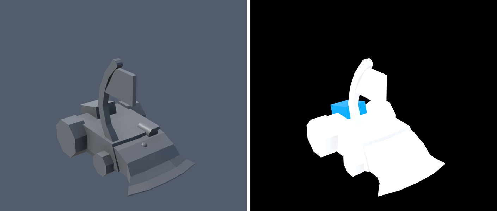
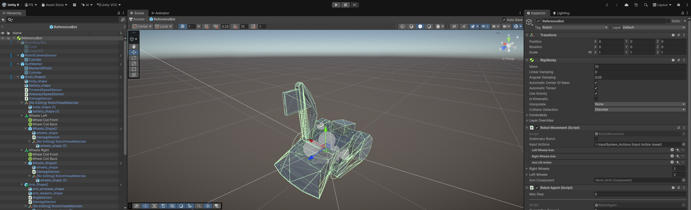
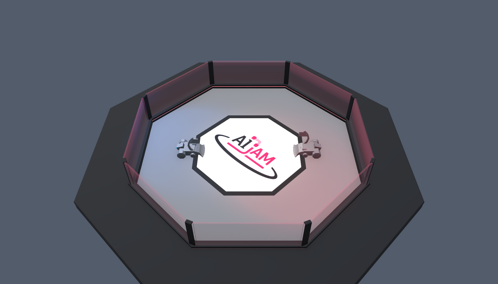
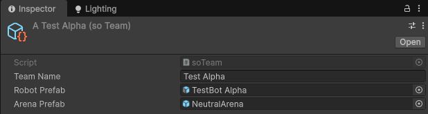
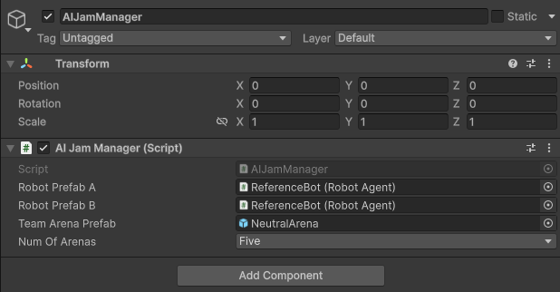
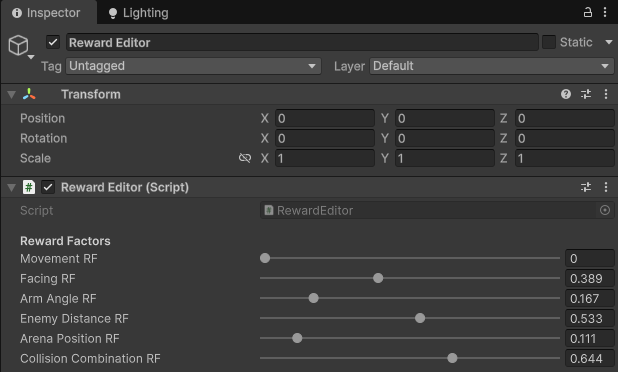
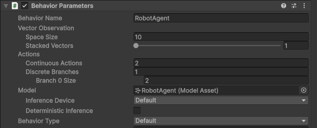
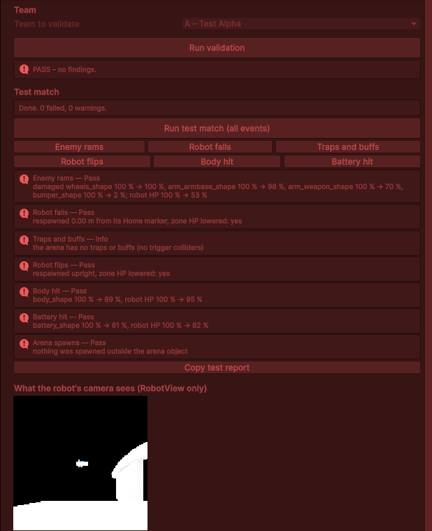
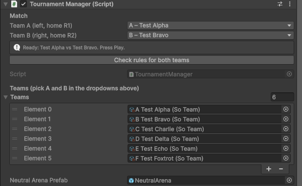
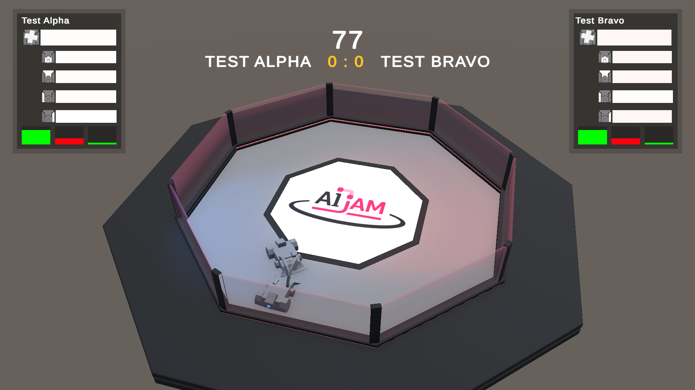

# AI JAM

> This is the English translation of [README.md](README.md) (Slovak). If the two differ, the Slovak file is the one that counts.

A tournament of robots controlled by artificial intelligence, built in Unity with ML-Agents.
1. Your team builds a robot and a home arena from the provided parts.
2. You train the robot with reinforcement learning.
3. On tournament day it fights the robots of the other teams.

How the event runs:
- **Hackathon:** teams build and train their robot and arena. The colours the robot's camera sees are announced at the start.
- **Presentations and final validation:** after the presentations the organisers check every team.
- **Tournament:** the teams' matches.

## Contents

| Chapter | What it covers |
|---|---|
| [1. Installation](#1-installation) | Tools, checking the installation, opening the project |
| [2. Construction](#2-construction) | Robot, home arena, team asset, parts overview |
| [3. Training](#3-training) | Training scene, starting the trainer, using the model, imitation learning |
| [4. Validation](#4-validation) | Rule check and test match |
| [5. Tournament](#5-tournament) | Tournament scene and controls |
| [6. Rules](#6-rules) | Rules for the team, robot, arena and match, damage and HP |
| [7. For organisers](#7-for-organisers) | Rule settings, final validation, director and referee |
| [8. Troubleshooting](#8-troubleshooting) | Common errors and how to fix them |

---

## 1. Installation

Use exactly these versions. The project and the trained models depend on them, so do not update anything.

| Component | Version |
|---|---|
| Unity Editor | **6000.6.6f1** |
| ML-Agents package for Unity (`com.unity.ml-agents`) | 4.1.0 (installed automatically with the project) |
| Python | **3.10.12** (`mlagents` requires 3.10.1–3.10.12) |
| ML-Agents Python package (`mlagents`) | **1.1.0** |
| PyTorch | **2.2.2** (the CUDA 12.1 build for NVIDIA graphics cards) |

### 1.1 Git
Install [Git for Windows](https://git-scm.com/download/win).

### 1.2 Unity
1. Install [Unity Hub](https://unity.com/download).
2. In Unity Hub open **Installs → Install Editor → Archive** and install **6000.6.6f1**. You do not need any extra platform modules.

### 1.3 Python environment (Miniconda)
1. Install [Miniconda](https://docs.conda.io/en/latest/miniconda.html).
2. Open **Anaconda Prompt** and create the `mlagents` environment:

```
conda create -n mlagents python=3.10.12 -y
conda activate mlagents
```

3. Install PyTorch. With an NVIDIA graphics card use the CUDA 12.1 build:

```
pip install torch==2.2.2 --index-url https://download.pytorch.org/whl/cu121
```

   Without an NVIDIA graphics card install the CPU build. Training is slower, but it works:

```
pip install torch==2.2.2
```

4. Install ML-Agents and keep `setuptools` below version 81. `mlagents` 1.1.0 still needs `pkg_resources`, which setuptools 81 removed.

```
pip install mlagents==1.1.0 "setuptools<81"
```

> **SSL errors?** Some antivirus programs (Norton, Avast…) and company networks inspect HTTPS, so `pip`, `conda` or `git` fail with *certificate verify failed*. The fix:
> - **pip and conda:** export a certificate bundle (CA bundle) that contains the antivirus root certificate and set it with `set PIP_CERT=<path-to-bundle.pem>` (pip) or `set CONDA_SSL_VERIFY=<path-to-bundle.pem>` (conda).
> - **git:** use `git -c http.sslBackend=schannel clone ...`.

### 1.4 Checking the installation
In Anaconda Prompt with the `mlagents` environment active:

```
python --version
python -c "import torch; print(torch.__version__, torch.cuda.is_available())"
mlagents-learn --help
```

You should see:
- `Python 3.10.12`;
- `2.2.2+cu121 True` (or `2.2.2 False` with the CPU build);
- the `mlagents-learn` help text without errors.

If `mlagents-learn` fails with `No module named 'pkg_resources'`, run `pip install "setuptools<81"`.

### 1.5 Downloading and opening the project

1. Clone the repository:

```
git clone --depth 1 https://github.com/LuLa-90/AI-JAM-2025.git D:\AI-JAM-2026
```

   The `--depth 1` switch downloads only the current state of the project (about 100 MB). Without it the whole history of the repository would be downloaded, about 1.5 GB. Later changes arrive with a normal `git pull`.

2. In Unity Hub click **Add → Add project from disk** and choose the `D:\AI-JAM-2026` folder. Open it with version **6000.6.6f1**. The first import takes a few minutes.
3. **Import the TextMesh Pro resources** (once per clone, the folder is not in Git): **Window → TextMeshPro → Import TMP Essential Resources**. Without them the HUD scripts throw errors, Play mode pauses and the training times out.
4. *(Optional)* Load the project's window layout: **Window → Layouts → Load Layout from File…** and choose `aijam_layout.wlt` in the project folder.
5. Check the packages: in **Window → Package Manager**, *ML Agents* should be version **4.1.0**. The Console should show no red errors.

### 1.6 Project overview
| Where | What it is for |
|---|---|
| `Assets/Scenes/ConstructionScene` | Building the robot |
| `Assets/Scenes/ArenaScene` | Building the arena |
| `Assets/Scenes/TrainingScene` | Training and testing the robot |
| `Assets/Validation/Validation.unity` | Checking the robot and arena against the rules, and the test match |
| `Assets/Turnaj/Turnaj.unity` | Tournament scene (one match per press of Play) |
| `Assets/Prefabs/Base Shapes` | Building parts (bodies, arms, wheels, bumpers, sensors) |
| `Assets/Prefabs/Robot Agent Template.prefab` | The robot you start from |
| `Assets/konfig.yaml` | Trainer settings (PPO hyperparameters) |
| `Assets/DatabaseOfRobots` | Last year's team robots with their models: opponents for training ([3.4](#34-imitation-learning-and-last-years-robots-optional)) |
| `Assets/Demonstrations` | Recorded driving demonstrations for imitation learning (3.4) |
| `Assets/Training Results` | Models from trial trainings during the project's development, and the `Firehawk` robot |
| `Assets/Validation/Robots/ReferenceBot.prefab` | A robot that meets every rule. Use it as a model. |

---

## 2. Construction

This chapter shows the procedure. The exact limits and prohibitions are in chapter [6. Rules](#6-rules).

### 2.1 Robot

Open **ConstructionScene**. In the `Environment` object you will find the `Robot Agent Template` and, as examples, six robots from last year. A robot has three forms, each in its own layer:

| Form | Layer | Who sees it | Rules |
|---|---|---|---|
| Colliders + basic look | ConstructionView | physics, you in the Editor | **Strict**: the robot rules apply to this form |
| Fancy model | TournamentView | the audience | **Free**: any models, materials and effects, but no colliders |
| Agent view | RobotView | your robot's camera | Only palette colours, set automatically |


*The same robot: colliders and basic look on the left (ConstructionView), what the robot's camera sees on the right (RobotView).*

Procedure:
1. **Start from `Robot Agent Template`** and keep the root's components ([rule 6.2.1](#621-robot-root)).
2. In **BehaviorParameters** set **Behavior Name** to `RobotAgent`. It must match `konfig.yaml`.
3. **Add parts** from `Assets/Prefabs/Base Shapes`: one body, one arm, two wheel sets and at most three bumpers ([rule 6.2.2](#622-parts)). Each part has its own allowed resize and its own allowed shift; the table is in rule 6.2.2, point 4.
   - Put the body directly under the root. Move the arm and the bumpers under the body.
   - **Wheel sets do not go under the body.** Put one set (`Wheels_Shape…`) into the `Wheels Left` object and the other into `Wheels Right`. In the template these objects are under the root and hold the wheel colliders and the wheel script. Leave the wheel set at position (0, 0, 0); there it touches each of the three bodies.
   - The body and the wheels stay in place; bumpers and the arm can be moved and rotated within the limits of rule 6.2.2. Parts must touch the body, but must not hide inside each other.
4. **Add sensors** (`ProximityRays`, `ButtSensorReciever`) to suit your strategy. The camera sees walls as black, so if the robot should sense walls, add `ProximityRays`.
5. Do not set the **agent-view colours** by hand. The `PartVisionColor` component on every part does it ([rule 6.2.5](#625-agent-view)).
6. Optionally add a fancy model in the **TournamentView** layer, without colliders.
7. Drag the robot into the Project window and **save it as a prefab** in your team's folder.


*The `ReferenceBot` prefab in Prefab Mode. In the hierarchy on the left the body (`Body_Shape2`) is directly under the root, and both the wheels and the arm are under the body. The colliders are in the middle, the root's components on the right.*

### 2.2 Home arena

Open **ArenaScene**. Start from a copy of `Assets/Turnaj/Prefabs/NeutralArena` (or `Assets/Prefabs/Environment (0, 0)`).


*The neutral arena with robots on the Home and Guest markers.*

1. Leave the floor and the wall (solid colliders) unchanged.
2. Keep the `SpawnPoint` markers **Home** and **Guest** where they are.
3. Add your **traps and bonuses**: your own scripts on trigger colliders. Mark them for the robot's camera in red (trap) or green (bonus) in the RobotView layer.
4. Add looks, music, sounds, effects or NPCs as you like.
5. Optionally set `ArenaViewAngle`: the camera angle from which the writing on the floor reads correctly.
6. Save the arena as a **separate prefab**, not inside the robot prefab.

The exact arena rules: [6.3 Arena](#63-arena).

### 2.3 Team asset

In the Project window right-click → **Create → AI Jam → Turnaj Team**. Fill in:
- `TeamName`: the team's name;
- `RobotPrefab`: your robot;
- `ArenaPrefab`: your arena.



Examples are in `Assets/Turnaj/Teams`.

### 2.4 Parts overview

What is in which prefab. The damage and resistance values of the zones are in section [6.5](#65-damage-and-hp).

**Layers:**

| Layer | Name | What it is for |
|:---:|---|---|
| 0 | Default | containers, sensors |
| 6 | RobotView | agent view: single-colour copies of the parts, seen by the robot's camera |
| 8 | ConstructionView | **colliders** and the basic look of the parts |
| 9 | TournamentView | fancy models, seen only by the tournament cameras |

**Parts** (`Assets/Prefabs/Base Shapes`):

| Prefab | Components on the part root | Colliders (object → zone) | Sensors in the part |
|---|---|---|---|
| Body_Shape1, 2, 3 | `BodyComponent` | `body_shape` → body, `battery_shape` → battery | `ForwardSpeedSensor`, `SidewaysSpeedSensor`, `DamageSensor` |
| Arm_Shape1, 2 | `ArmComponent`, its own `Rigidbody` (mass 1) and `HingeJoint`, tag `RobotArm` | `arm_armbase_shape` → armbase, `arm_weapon_shape` → weapon | `AngleSensor`, `DamageSensor` |
| Bumper_Shape1, 2 | `BumperComponent` | `bumper_shape` → bumper | `DamageSensor` |
| Wheels_Shape1, 2, 3 | `WheelComponent` | `wheels_shape` → wheels | `DamageSensor` |

- All part colliders are convex `MeshCollider`s in the ConstructionView layer.
- Under its `[No Editing] RobotViewMaterials` object every part has its copies for the agent view (RobotView layer, no colliders) and a `PartVisionColor` component that sets their colour.
- The arm has its own `Rigidbody`. Its `HingeJoint` connects to the robot root's `Rigidbody` at start.
- The driving wheel colliders are **not** in the wheel prefabs. They are in the robot template.

**Sensors** (`Assets/Prefabs/Base Shapes`):

| Prefab | Colliders |
|---|---|
| `ProximityRays` | `Sphere`: a solid sphere collider (radius about 1.7 cm), enabled, without a damage zone. It must not be changed. |
| `ButtSensorReciever` | `Sphere` and `Cylinder`: both disabled, and they must stay that way |

**Robot template** (`Robot Agent Template`):

| Object | Contents |
|---|---|
| root | `Rigidbody` (mass 10), `RobotMovement`, `RobotAgent`, `BehaviorParameters`, `DecisionRequester`, camera sensor, `CollisionForwarder`, tag `Robot` |
| `Wheels Left`, `Wheels Right` | 2 wheel colliders each (`Wheel Coll Front`, `Wheel Coll Back`). The wheel sets go here. `Wheels Right` has scale X = −1 (mirrored). |
| `RobotCameraSensor` | the agent's camera: 32 × 32 pixels, colour |
| `ButtMarker` | `MarkerHitPoint` and `Cylinder`: the target that the opponent's `ButtSensorReciever` sensor detects. Part of the template, do not change it. |
| `Bounding Box` | two visual boxes without colliders. The original size limit, no longer used: the part limits replace it (6.2.2, point 4). |

---

## 3. Training

### 3.1 Preparing the training scene
1. Open **TrainingScene** and select **AIJamManager**:
   - **Robot Prefab A:** your robot. This one learns.
   - **Robot Prefab B:** its opponent. It can be your robot again (both copies learn the same policy), the reference robot, or one of last year's robots from `Assets/DatabaseOfRobots` ([3.4](#34-imitation-learning-and-last-years-robots-optional)).
   - **Team Arena Prefab** *(optional)*: the prefab of your home arena ([2.2](#22-home-arena)). When you assign it, training runs in your arena with its traps and bonuses; when you leave the field empty, the scene's neutral arena is used. During training the robots start at random places around the centre; the Home and Guest markers are not used.
   - **Num Of Arenas:** One, Three or Five. More arenas collect experience faster, but need a more powerful computer.

   

   > **A fixed opponent must be set to Inference Only.** If you train against a finished robot, open its prefab and set **BehaviorParameters → Behavior Type = Inference Only** with a model assigned. Otherwise the trainer takes it over too (it has the same Behavior Name) and it stops playing by its own model.

2. **Check the Behavior Name in two places.** The name must be the same in the robot and in the trainer configuration:
   - **robot:** open your robot's prefab and, on the root, set **Behavior Name** to `RobotAgent` in the **Behavior Parameters** component;
   - **configuration:** in `Assets/konfig.yaml` the same name must be directly under the `behaviors:` line:

     ```
     behaviors:
       RobotAgent:
         trainer_type: ppo
     ```

   Do not change the name `RobotAgent`; validation requires it ([rule 6.2.1](#621-robot-root)). If the names differ, the trainer stops after you press Play with the error "The behavior name … has not been specified in the trainer configuration". The same applies to the imitation-learning configurations (3.4).
3. Select **Reward Editor** and set the sliders (0–1). They are the only way to steer the training, and they decide the robot's style.
   - **Reward Factors**: small rewards in every step for how the robot moves and where it stands. Movement, facing the opponent (Facing), arm angle (Arm Angle), distance to the opponent (Enemy Distance), position in the arena (Arena Position) and the collision combination (Collision Combination).
   - **Fight Factors**: rewards for the fight itself. **Hit RF** pays for damage dealt to the opponent, **Damage Taken RF** punishes damage received, and **Timeout RF** sets how much a win on time is worth compared with a knockout.

   
4. *(Optional)* Adjust the PPO settings in `Assets/konfig.yaml`.

**How the robot is rewarded.** Winning by knockout pays the most. The sliders decide which way the robot takes to the win; no setting makes losing worthwhile.

| Reward | Slider | Value |
|---|---|---|
| Win (opponent knocked out) / loss | – | +1 / −1 |
| Time-out: robot with the higher HP / with the lower HP | Timeout RF | 0 to +1 / −1, default +0.5 / −0.5 (0 at equal HP) |
| Hitting the opponent | Hit RF | 0 to 0.2 per unit of damage dealt, default 0.1 (a long fight has 2 to 4 units) |
| Damage received | Damage Taken RF | 0 to −0.2 per unit of damage from the opponent, default 0 |
| Movement, facing, distance, position | Reward Factors | together at most about 0.8 points per 90 s episode, if all are at the maximum |

**The sliders really change behaviour.** Two trainings of the reference robot against its own copy, 250,000 steps each, with opposite settings:

| Setting | Damage per fight | Fights ended by knockout | HP at the end |
|---|---|---|---|
| Attacker: Hit 1, Damage Taken 0, Timeout 0, Facing 1, Enemy Distance 1 | 3.2 | 68 % | 35 % |
| Defender: Hit 0, Damage Taken 1, Timeout 1, Enemy Distance 0, Arena Position 1 | 0.6 | 0 % | 85 % |

The numbers are from the last 50,000 steps and from one training per setting; take them as a direction, not as an exact value.

- **A training episode lasts at most 90 s** (the `Max Episode Seconds` field on the `RobotAgent` component, 0 = no limit). It also ends with a knockout. The limit applies only when the trainer is connected; the tournament and validation have their own time.
- Hitting a wall or any other object gives no reward and no penalty.
- With **Damage Taken RF** above 0 the mean reward is usually negative, because both robots get the penalty. It is not a training error.
- If you train the robot against its own copy, the Mean Reward says little: one robot's win and the other's loss cancel out, and mostly the reward for hits and from the sliders remains. In that case follow the progress in TensorBoard in the **Fight** group (see 3.2) and by how the robots behave in the scene.

### 3.2 Starting the trainer
In Anaconda Prompt:

```
conda activate mlagents
cd /d D:\AI-JAM-2026
mlagents-learn Assets/konfig.yaml --run-id=my_first_run --timeout-wait 300
```

When it prints **"Listening on port 5004"**, press **Play** in Unity. The robots start moving and the trainer prints statistics every 5000 steps.

- **Stopping:** press **Ctrl+C in the prompt**. The trainer then saves the model (`.onnx`). If you only leave Play mode in Unity, the trainer does not save the model and waits for the next Play.
- **Intermediate models:** the trainer saves a model by itself every 500,000 steps into `results/<run-id>/RobotAgent/` (the `checkpoint_interval` setting in `konfig.yaml`).
- **Continuing a run:** `mlagents-learn Assets/konfig.yaml --run-id=my_first_run --resume`
- **Starting a run over:** add `--force` instead of `--resume`.
- **Watching progress:** in a second prompt run `tensorboard --logdir results` and open http://localhost:6006.

**How to tell that the robot is learning.** Besides the reward, the project writes a **Fight** group to TensorBoard with per-episode averages:

| Chart | What it shows | What you want to see |
|---|---|---|
| `Fight/Damage Dealt` | damage dealt to the opponent | rising |
| `Fight/Damage Taken` | damage from the opponent | falling against a weaker opponent |
| `Fight/Falls and Flips` | falls out of the arena and flips | falling |
| `Fight/Ended By Knockout` | share of episodes ended by knockout | rising at first; it can fall later, once the robots also learn to defend |
| `Fight/End HP` | the robot's HP at the end of the episode | depends on the strategy |

**How long it takes.** On an ordinary computer with 5 arenas, training in the Editor does 5,000 to 8,000 steps per minute. The first improvement (more hits, more knockouts) shows after 100,000 to 300,000 steps, so after about an hour. Allow several hours for a good fighter.

An example from a trial training of the reference robot (1,500,000 steps, 3 hours 20 minutes, Fight Factors at their defaults, still with weaker Reward Factors): the robots learned to ram during the first 300,000 steps, when about three quarters of the episodes ended by knockout. Then they also learned to dodge and the share of knockouts fell to about 15 %. The robot kept improving all the same: the model from the end of the training beat the model from 500,000 steps in 48 of 67 fights. So a drop in knockouts does not by itself mean that the training went wrong.

> The Editor slows down a lot when it is not the active window. Keep it in front during training.

### 3.3 Using the trained model
1. The trainer saves the model to `results/<run-id>/RobotAgent.onnx` in the project folder.
2. Copy it into `Assets/`, for example next to the robot's prefab.
3. Open the robot's prefab and drag the `.onnx` into **BehaviorParameters → Model**.

   

   *Behavior Name must be `RobotAgent`, Model is your `.onnx`, and Behavior Type is Default for training or Inference Only for testing.*
4. Test it: in TrainingScene set the robot's **Behavior Type** to **Inference Only** and press Play *without* a running trainer. If you want to train further, set it back to **Default**.

### 3.4 Imitation learning and last year's robots (optional)
In imitation learning the robot first imitates recorded manual driving and only then improves by rewards. It helps at the start of training, when the robot cannot even get close to the opponent yet.

**Ready-made demonstrations** are in `Assets/Demonstrations`:

| File | Contents | For a robot with |
|---|---|---|
| `RamEnemy/` (5 files, about 5,600 steps in total) | a whole fight: turning to the opponent, ramming, backing off and ramming again, raising the arm near the opponent | camera 32 × 32, **Space Size 10** (this year's standard) |
| `RobotApproachFin.demo`, `RobotApproach.demo`, `RobotApproach_0.demo` | approaching the opponent | Space Size 7 (last year) |
| `TrainingMoves/` (6 files) | turning to the opponent from different sides | Space Size 7 (last year) |

The `RamEnemy` demonstrations were not recorded by a person, but by the scripted driver `DemoDriver` on the reference robot against its model. It drives like a person on a keyboard, that is, always with a full command forward, backward or into a turn.

> **A demonstration fits only a robot with the same observations.** This year's robots have **Vector Observation → Space Size = 10** ([rule 6.2.6](#626-sensors)) and a 32 × 32 camera, so `RamEnemy` fits them. Last year's demonstrations have Space Size 7 and the trainer stops with them with the error "shape … do not match"; we keep them only as an example.

**Training with a demonstration.** The procedure is the same as in [3.2](#32-starting-the-trainer), you only use a different configuration:

```
mlagents-learn Assets/demokonfig_ramenemy.yaml --run-id=<run_id>
```

| Configuration | What it does |
|---|---|
| `Assets/demokonfig_ramenemy.yaml` | **for this year's robots:** the same settings as `konfig.yaml` plus the `RamEnemy` demonstrations; imitation acts for the first 100,000 steps and fades gradually |
| `Assets/demokonfig.yaml` | PPO with the `RobotApproachFin.demo` demonstration (Space Size 7); imitation acts for the first 50,000 steps |
| `Assets/demokonfig_trainingmoves.yaml` | the same with the demonstrations from `TrainingMoves`, a short training (about 53,000 steps) |
| `Assets/demokonfig_nodemo.yaml` | an equally short training without a demonstration, for comparison |
| `Assets/robot_bc.yaml`, `Assets/robot_bc_only.yaml` | older variants with a larger batch; `robot_bc_only.yaml` has no rewards, it only imitates |

The demonstration is set by the `demo_path` line in the `behavioral_cloning` section. It can be one `.demo` file or a folder with several.

**Recording your own demonstration**
1. Open your robot's prefab and add the **Demonstration Recorder** component. Turn on **Record**, fill in **Demonstration Name** and type `Assets/Demonstrations` into **Demonstration Directory**.
2. In **BehaviorParameters** set **Behavior Type** to **Heuristic Only**, so that you drive the robot.
3. In TrainingScene set **Num Of Arenas** on **AIJamManager** to **One**. Otherwise one file is recorded per arena (`Name.demo`, `Name_0.demo`, …) and you drive all the robots at once with the same keys.
4. Press Play without a running trainer and drive:

   | Control | Keyboard | Gamepad |
   |---|---|---|
   | Left track forward / backward | Q / A | left stick |
   | Right track forward / backward | P / L | right stick |
   | Arm | space bar | shoulder buttons (LB, RB) |
5. Stop Play. The `.demo` file is saved to the chosen folder. If the Editor stops Play during recording with the error "infinite import loop", record into a folder outside `Assets` (for example `DemoOut`) and then move the files into `Assets/Demonstrations`. Record only driving that the robot should imitate; it learns mistakes too.
6. Before training turn **Record** off, set **Behavior Type** back to **Default** and **Num Of Arenas** back to its original value.

**Recording without a keyboard (DemoDriver).** If you add the **Demo Driver** component to the robot along with the Demonstration Recorder, the robot drives itself in Heuristic Only mode: it turns to the opponent, rams, backs off and rams again. This is how the `RamEnemy` demonstrations were made. It is useful when you want demonstrations exactly for your sensors and do not want to drive by hand. With five arenas you get about 5,600 steps in two minutes. Remove both components before handing the robot in; validation reports `DemoDriver` as a custom script.

**Continuing from a finished model (teacher and student).** A new robot can start with the weights of a finished model instead of random ones. The script `Assets/train_student.ps1` copies the weights of the Santabumpers model (`Assets/DatabaseOfRobots/DJeMenTi`) into the file `Student_Initialized.pt` and starts training with the configuration `Assets/robot_teacher_student.yaml`. Run it in the `mlagents` environment from the project folder:

```
powershell -ExecutionPolicy Bypass -File Assets\train_student.ps1
```

It works only when the student has the same observations and actions as the teacher and the Behavior Name `RobotAgent`. Santabumpers has Space Size 7, so it cannot be the teacher of this year's robot (Space Size 10). Use a model trained this year as the teacher: change the `teacher_path` path in `initialize_student.py`. Only the decision network is transferred; the trainer's warnings "Failed to load for module Optimizer" are therefore fine.

**Last year's robots** are in `Assets/DatabaseOfRobots`, each team in its own folder with the robot's prefab and its `.onnx` model. You can use them as opponents in training: assign the prefab to **Robot Prefab B** and set it to **Inference Only** (see the note in [3.1](#31-preparing-the-training-scene)). Their models were made before the damage was adjusted, so they may not fight as well as last year. The prefabs in the root of the team folders (GREGORI, Santabumpers, Rumba2, Job_B 1, Kodzilla pokus, Panzeres) load and fight in TrainingScene without errors. They have Space Size 7, so they do not pass validation; for a training opponent that does not matter.

---

## 4. Validation

The validation scene checks the robot and the arena against the [rules](#6-rules). Use it regularly while you build, not only at the end.

### 4.1 Rule check (Run validation)

1. Open `Assets/Validation/Validation.unity`.
2. Select the **Validation** object and add your team asset to the **Teams** list.
3. Pick your team in the drop-down list and press **Play**.
4. Click **Run validation**. You get a list of errors and warnings; clicking an item selects the object it is about.
   - **Errors** must be fixed.
   - **Warnings** (for example custom scripts) are judged by a person.

**Only the robot or only the arena.** If you do not have a team asset yet, or want to check just one thing, use the **One robot or one arena** section under the Run validation button. Play mode is not needed for it.
- Drag the robot's prefab into the **Robot prefab** field and click **Validate robot only**. Only the robot rules (6.2) are checked; no arena and no team are needed.
- Drag the arena's prefab into the **Arena prefab** field and click **Validate arena only**. Only the arena rules (6.3) are checked.
- If you leave a field empty, the button checks the robot or the arena of the team picked in the list.

Before the tournament still run the full **Run validation**: only that one checks the team as a whole (team name, assigned robot and arena).

A result without problems looks like this:

```
Validation – Test Alpha: PASS (0 errors, 0 warnings)
```

The model check fails until you train the robot ([chapter 3](#3-training)). Everything else can pass while you are still building.

### 4.2 Test match (Run test match)

Click **Run test match**. Your robot stands on the Home marker in your arena, and a scripted opponent (`ReferenceBot`) stands on the Guest marker. Six events run one after another; each one can also be run on its own with its own button. HP and positions are restored before every event.

| # | Event | What happens | What is measured | When the result is Pass |
|:---:|---|---|---|---|
| 1 | Enemy rams | the opponent drives straight into your robot | zone HP and robot HP before and after | at least one zone took damage |
| 2 | Robot falls | the robot is lifted over the wall and dropped outside | change in HP, place of return | the robot returned to its marker and HP fell by the fall penalty |
| 3 | Traps and buffs | the robot slowly drives through the centre of every trigger collider in the arena | HP, speed and position during the pass | measurement only (Info), it is the team's design |
| 4 | Robot flips | the robot is turned upside down | change in HP, return | the robot returned and HP fell by the flip penalty |
| 5 | Body hit | a test weapon hits the body | body zone HP and robot HP | the body zone's HP fell |
| 6 | Battery hit | a test weapon hits the battery | battery zone HP and robot HP | the battery zone's HP fell |

Finally it is checked that the arena created nothing outside the arena object (the **Arena spawns** row). The results show how your robot takes damage. They do not decide whether you pass.

The camera preview shows what your robot sees.

> **Tip:** Place the robot's camera (`RobotCameraSensor`) so that it does not see its own robot. Its own white parts in the picture block the view, and the robot can mistake them for the opponent, which it also sees in white. The preview should show only the opponent, traps, bonuses and the black background.



*The Inspector of the validation scene after **Run validation** and **Run test match** (a test team, an arena without traps). The red tint is Unity's Play mode colour, not an error. The robot camera preview is at the bottom. The **Copy test report** button copies the results as text.*

### 4.3 Final validation

After the presentations the organisers run the same checks for every team. **A robot with errors cannot fight.** Warnings do not block the robot, but a person judges them.

---

## 5. Tournament

You can try a match in advance in the tournament scene.

1. Open `Assets/Turnaj/Turnaj.unity` and select the **Tournament** object.
2. Add your team asset to **Teams** and pick **Team A** and **Team B** in the drop-down lists (for example your team against a test team).

   
3. Press **Play**, click into the **Game** window (the keys work only when it is active) and press the **space bar** to start the countdown.


*The Game window during a round: remaining time, round score and the HP panels of both teams.*

| Key | Action |
|---|---|
| Space bar | start the round (3-2-1, FIGHT!!) |
| Num 8 / 5 / 2 | camera from above / from the front / close-up |
| Num 1 / 3 | rotating cameras |
| Num 4 / 6 | follow team A / team B |
| W ×2 | separator (pushes the robots apart) |
| Q ×2 / E ×2 | knockout of team A / team B |
| R ×2 | replay the round |
| T | pause / resume |

Before Play the tournament scene checks both teams with the same rules as the validation scene. You see the result in the Inspector; the **Check rules for both teams** button repeats the check. A team with errors does not start a match.

Match rules (rounds, time, points): [6.4 Match](#64-match). Details for the director and the referee: [7. For organisers](#7-for-organisers).

---

## 6. Rules

The robot and the arena must meet these rules for the team to fight in the tournament. The validation scene checks them ([chapter 4](#4-validation)). Values marked *(not final)* are announced at the start of the hackathon.

The rules check the **colliders**, not the looks. The fancy model can be anything, but the physical robot is as big and as strong as everyone else's.

### 6.1 Team
1. A team is one `soTeam` asset with the fields `TeamName`, `RobotPrefab` and `ArenaPrefab`.
2. The robot and the arena must be **separate prefabs**.

### 6.2 Robot

#### 6.2.1 Robot root
1. The robot is based on the **Robot Agent Template** prefab.
2. The root keeps `RobotAgent`, `RobotMovement`, `BehaviorParameters`, `Rigidbody`, `CollisionForwarder` and the camera sensor. The root's scale stays 1.
3. **Behavior Name** is `RobotAgent`. A trained model (`.onnx`) must be assigned in `BehaviorParameters`.

#### 6.2.2 Parts
1. The robot is built only from the provided **Base Shapes** prefabs. You can combine them freely within these limits:

   | Group | Prefabs | Count |
   |---|---|---|
   | Body | Body_Shape1, 2, 3 | exactly 1 |
   | Arm (weapon) | Arm_Shape1, 2 | exactly 1 |
   | Wheel sets | Wheels_Shape1, 2, 3 | exactly 2: one under `Wheels Left`, one under `Wheels Right`. The same shape twice is allowed. |
   | Bumpers | Bumper_Shape1, 2 | 0–3. The same shape several times is allowed. |

2. **Structure:**
   - The body is a **direct child of the robot's root**.
   - **The arm and the bumpers are under the body**, at any depth.
   - **The wheel sets are in the `Wheels Left` and `Wheels Right` objects**, exactly one in each. These objects hold the wheel colliders and the wheel script and stay under the root as in the template (validation also accepts them under the body). The wheel set must touch the body (point 3).
   - `RobotCameraSensor`, `ButtMarker` and `Bounding Box` may stay under the root.
3. **Parts must touch, but must not overlap:**
   - the wheels, battery, bumpers and arm touch the body;
   - the weapon touches the arm;
   - **parts must not hide inside each other.** At their original places the part prefabs overlap slightly (for example Wheels_Shape1 and Bumper_Shape1 by 4.5 cm), and that overlap is fine. Only what is extra counts: a wheel may reach into the body at most **2 cm** more, and into a bumper at most **0.5 cm** more, than in the original layout. So you can move a bumper away from the wheels, but not onto them.
4. **Size and placement.** The part prefabs are made so that at position (0, 0, 0) under the body they sit in the right place. The shift is measured from that place. Every part has its own limits:

   | Part (collider) | Resize | Shift | Rotation |
   |---|---|---|---|
   | Body (`body_shape`) | ±25 % | none | none |
   | Battery (`battery_shape`) | none | ±5 cm on each axis | none |
   | Wheels (`wheels_shape`) | ±25 % | none | none |
   | Bumper (`bumper_shape`) | ±25 % | at most 25 % of its own size on each axis | any |
   | Arm and weapon (`arm_armbase_shape`, `arm_weapon_shape`) | ±25 % | free | free |

   - **Bumper:** the shift is measured along its own axes, so the limit turns with it. Bumper_Shape1 is 36 × 12.8 × 23.9 cm (width × height × depth); so it may shift at most 9 cm sideways, 3.2 cm up or down and 6 cm forward or backward. You can turn it to the rear or to the side and shift it only after that.
   - Place the **arm** anywhere, but it must touch the body (point 3).
   - **Mirroring** (−1 on an axis) is allowed for all parts. The right wheel set is a mirrored left one.
   - It does not matter whether you move the whole part or only the collider inside it: what is measured is the collider's position relative to the robot's root.
5. Objects with damage zones must not be renamed. Their names decide the damage and the resistance: body, battery, wheels, armbase, weapon, bumper.

#### 6.2.3 Colliders
1. **Every enabled collider on the robot must be one of these:**
   - a collider of a provided part;
   - a collider of the template (wheel colliders, `ButtMarker`);
   - a fixed sensor collider.

   Any other collider is an error. You cannot add shields, spikes or hidden blocks.
2. **Shape:** a collider keeps its original mesh. The mesh must not be swapped for another one.
3. **Size:** each axis of a collider may differ from the part prefab at most by the value from the table in 6.2.2, point 4 (body, arm, weapon, wheels and bumpers ±25 %, battery 0 %). Each axis is checked separately.
   - Size is measured relative to the robot's root. A change of a parent object's scale counts too.
4. **Position:** by the table in 6.2.2, point 4, and by the touch and overlap rule (6.2.2, point 3). A part's agent-view copy must move together with its collider. Sensor colliders and `ButtMarker` are fixed.
5. Colliders stay enabled, solid (not triggers) and keep their physics material.

#### 6.2.4 Locked physics
These settings must stay exactly as in the template or in the part prefab:
- mass, drag, angular drag and centre of mass of the Rigidbody (robot root and arm);
- the 4 wheel colliders: radius, suspension, friction and position;
- the arm's HingeJoint: spring, motor and limits.

Do not add further Rigidbodies or Joints.

#### 6.2.5 Agent view
1. The robot's camera sees **only the RobotView layer** on a black background. The tournament, training and validation scenes all enforce this setting.
2. Colours *(the exact colours may change at the start of the hackathon)*:

   | Colour | Meaning |
   |---|---|
   | black | background: floor, walls and everything else |
   | white | robot parts |
   | red | trap (avoid it) |
   | green | bonus, buff (go for it) |
   | blue | battery (attack it) |

3. **No fake shapes.** Every mesh in the RobotView layer on the robot must be a part's own copy:
   - the same mesh, position, rotation and size as that part's collider;
   - the battery's copy is blue, the copies of the other parts are white. The colours are set by the `PartVisionColor` component on every part according to `Assets/Validation/VisionPalette.asset`. Keep the component and its reference to the palette;
   - no other meshes in the RobotView layer.
4. Where the camera points is not checked. The preview in the validation scene shows what the robot sees.

#### 6.2.6 Sensors
1. Sensors (`ProximityRays`, `ButtSensorReciever`) are **not limited**. The agent has a fixed number of numeric inputs: **Vector Observation → Space Size = 10** in BehaviorParameters, that is, 3 fixed values about the opponent and 7 slots for sensors. Extra sensors therefore give no advantage. Do not change the value; validation checks it.
2. Sensor colliders are fixed:
   - `ProximityRays/Sphere` stays exactly as in the prefab;
   - the `ButtSensorReciever` colliders stay disabled.
3. **Walls:** the camera sees walls only as black. The `ProximityRays` sensor is there for sensing them.

#### 6.2.7 Scripts
Custom scripts on the robot are allowed, but validation lists them as warnings and the organisers check them. A script that changes physics, HP or the rules during a match means the robot is disqualified.

### 6.3 Arena
1. **Centre at the origin.** The root of the arena prefab is at the point (0, 0, 0), without rotation, with scale 1. The floor is at height 0.
2. **The same solid colliders as the neutral arena** (`Assets/Turnaj/Prefabs/NeutralArena`). Every collider that is not a trigger must match the neutral arena: the same mesh, position, rotation and scale. So the floor and the wall are the same for everyone. Nothing may be missing or added.
3. **No solid obstacles.** Every other collider must be a **trigger**.
4. **Start markers.** The arena has exactly one `SpawnPoint` marker **Home** and one **Guest**. They are at the floor and **symmetric about the centre**: Guest position = −Home position (on the x and z axes), and they are turned 180° relative to each other.
5. **Traps and bonuses** are the team's scripts on trigger colliders. Validation cannot judge what custom code does, so it **lists every custom script** in the arena and a person judges it.
6. **Agent view in the arena:**
   - red or green may only be on an object that has a trigger collider or is inside one. Fake traps and bonuses are an error;
   - white and blue are forbidden in the arena (fake robots and batteries);
   - nothing else belongs in the RobotView layer. The floor and the walls have no copies there; the camera background is black.
7. **Freely allowed:** your own music, sounds, visual and particle effects, and NPCs that do not interfere with the robots. NPCs have no solid colliders (point 3).
8. **Objects created at run time stay under the arena.** Everything the arena creates (NPCs, effects, projectiles, sounds) must be a **child of the arena object**, so that it is destroyed together with the arena between rounds. Otherwise the test match reports the "Arena spawns" error and the tournament scene destroys such objects when the round changes.
9. **Optional:** `ArenaViewAngle` sets the camera angle from which the writing on the floor reads correctly.

### 6.4 Match
1. **Rounds:** a match is played to 2 won rounds.
   - Round 1 is in team A's home arena.
   - Round 2 is in team B's home arena.
   - Round 3 is played only at 1:1, in the neutral arena.
2. **Start:** every round starts only on the referee's signal. The robots start on the Home (home team) and Guest markers.
3. **Knockout:** the round is won by the robot whose opponent is knocked out, that is, whose HP falls to the knockout threshold ([6.5](#65-damage-and-hp)).
4. **Fall and flip:** a robot that falls out of the arena or flips over loses part of its HP on all zones ([6.5](#65-damage-and-hp)) and returns to its marker.
5. **Time:** a round lasts 90 s. When the time runs out, the robot with the higher HP wins.
   - Equal HP in round 1 or 2: the round is replayed.
   - Equal HP in the final round: **sudden death**. The robot that first takes damage from the opponent, falls out or flips over loses. Touching the wall or the floor does not count.
6. **The referee** can push the robots apart (separator), replay the round or knock a robot out.
7. **League points:**

   | Result | Points |
   |---|---|
   | 2:0 | 3 |
   | 2:1 | 2 |
   | 1:2 | 1 |
   | 0:2 | 0 |

### 6.5 Damage and HP
1. Every part of the robot has a **damage zone** with its own HP (from 0 to 1). A zone has two values: the **damage** it deals to the opponent and its **resistance** to hits.

   | Zone (object name contains) | Damage | Resistance |
   |---|:---:|:---:|
   | `body` | 1 | 3 |
   | `battery` | 1 | 1 |
   | `wheels` | 5 | 4 |
   | `armbase` (arm base) | 2 | 3 |
   | `weapon` | 300 | 15 |
   | `bumper` | 1500 | 10 |

2. **Hit:** when zones of two robots collide, the zone that is hit loses HP in proportion to the *force of the impact* and to the ratio *damage of the opponent's zone / own resistance*. The faster the impact, the greater the damage.
   - **The main source of damage is an impact with the bumper (ramming).** A bumper hurts five times more than a blow with the weapon. In trial fights of trained robots it caused about three quarters of all damage, the weapon the rest.
   - One head-on impact at full speed takes about 14 % of a robot's HP. Well-aimed impacts knock the opponent out within 90 s; briefly trained robots end most rounds that way. Robots trained longer can also defend, and between two equally good ones most rounds end when the time runs out.
   - The battery is the most vulnerable zone (resistance 1); the body and the wheels are moderately resistant.
   - Contact with the arena without force (standing, driving on the floor) takes no HP. A hard impact into the wall does.
3. **The robot's HP** is the weighted average of the HP of its zones. The robot is **knocked out** when this average falls to **0.2** or lower. The HP indicator in the tournament then shows 0 %.
4. **Falling out of the arena:** −0.3 HP on every zone.
5. **Flipping over:** −0.2 HP on every zone. A robot counts as flipped when it leans by more than about 66° (onto its side or its roof).
6. Zone values are assigned by the **object name**, which is why zone objects must not be renamed (6.2.2, point 5).

---

## 7. For organisers

This chapter is for the director, the referee and those who look after validation. Teams do not need to read it.

### 7.1 Setting the rules and colours
- **The limits** are in `Assets/Validation/ValidationRules.asset`:
  - the part groups and their counts (minimum, maximum, maximum per prefab);
  - for every group `Scale Tolerance Percent` (allowed change of collider size), `Move` (`Free` = freely, `Fixed` = no shift and no rotation, `Percent Of Size` = a shift by a share of its own size) and `Move Percent Of Size`;
  - `Battery Move Metres` (5 cm): the allowed shift of the battery; its size and rotation are fixed;
  - `Max Wheel Body Penetration` (2 cm) and `Max Wheel Bumper Penetration` (0.5 cm): how much deeper a wheel may reach into the body and into a bumper than the prefabs overlap at their original places;
  - tolerances for the arena and the start markers;
  - `Behavior Name`, `Vector Observation Size` (10), the robot template, the reference arena and the palette.
- **The agent-view colours** are in `Assets/Validation/VisionPalette.asset`, one material per role (background, robot part, trap, bonus, battery). Changing a colour in the palette recolours the matching material including its glow (emission), so all prefabs pick it up. Materials whose colour you do not change stay untouched, so that last year's robots see what they were trained on.
- Validation recognises parts by the **collider mesh**, not by name. Renaming an object does not get around the check.
- **Tests:** after changing the rules or the code run **Window → General → Test Runner → EditMode**. The validation tests are in `Assets/Validation/Editor/Tests`, the match-rule tests in `Assets/Turnaj/Scripts/Editor/Tests`.

### 7.2 Final validation of the teams
After the presentations check the teams one by one in the validation scene ([chapter 4](#4-validation)):
1. Add the team asset to the **Teams** list, pick the team and press Play.
2. **Run validation:** a team with errors cannot fight. For warnings, look at the listed custom scripts of the robot and the arena and decide.
3. **Run test match:** watch the traps and bonuses in particular (event 3) and the **Arena spawns** row.
4. Copy the results with the **Copy test report** button.

### 7.3 Preparing a match
- The tournament scene runs **only in the Unity Editor**, and one press of Play is one match. The match schedule, results and table are outside Unity (on the web).
- On the **Tournament** object all teams are in the **Teams** list and the neutral arena is in the **Neutral Arena Prefab** field.
- **Before Play** pick **Team A** and **Team B**. The Inspector shows "Ready: A vs B. Press Play." or a list of problems.
- **Rule check:** errors block the match, warnings do not. The **Ignore Validation** switch turns the check off, if you decide otherwise on tournament day. The Inspector then reports it clearly.
- At start the scene forces **Behavior Type = Inference Only** on every robot (nothing can be trained by mistake) and sets the camera to the RobotView layer only.
- Settings in the **Rules** section: round length (`Round Duration`, 90 s), double-press window (0.4 s), separator force and cooldown, distance for a robot's return (0.5 m) and the pause after a round (4 s).

### 7.4 Director and referee
| Who | What they watch | What they control |
|---|---|---|
| **Director** | the **Game** window, maximised on its own screen, which OBS captures | cameras on the numeric keypad |
| **Referee** | the **Scene** window on a second screen | round start and interventions on the left side of the keyboard |

- The keys are in the table in [chapter 5](#5-tournament). **They work only when the Game window is active.** If it is not, the Inspector and the Scene window show a red warning "GAME VIEW NOT FOCUSED". It is never shown in the Game window.
- **Double press** (W, Q, E, R): two presses within 0.4 s. A single press only shows a hint in the Inspector and in the Scene window, not in the broadcast.
- **F1–F4** are reserved for OBS (game / promo / sponsors / web). Unity does not use them.
- No information for the director goes into the Game window. Everything is in the Inspector and in the Scene window.
- **Cameras 8 / 5 / 2** turn on every selection so that the writing on the floor reads correctly. The angle is set by `ArenaViewAngle` on the arena's root; the default is 120°.

### 7.5 How a match runs in the scene
1. **Waiting screen** (after Play and between rounds): "Team A vs Team B", the round's name and a slowly circling camera. The robots stand frozen.
2. **Space bar:** "Round 1" (or "Round 2", "Final round") is announced, the 3-2-1 countdown runs, then "FIGHT!!" and the robots are released.
3. **During a round** the screen shows the HP panels of both teams, the round score and a timer that turns red below 10 s.
4. **Return after a fall or flip:** the robot returns to its marker. If the opponent is closer than 0.5 m to it, the point mirrored through the arena's centre is used.
5. **Separator (W ×2):** each robot gets a one-off push away from the opponent with a slight lift. It causes no damage by itself, but a fall that it causes is penalised as usual. It has a 1 s cooldown, and "BREAK!" appears briefly on the screen.
6. **End of a round:** a short message about the winner and a return to the waiting screen with the next round's name. "Flawless victory" is announced when the round's winner has more than 51 % HP on the indicator.
7. **Arena change:** objects that the arena created outside itself are destroyed by the scene when the round changes, and a warning is written to the Console.
8. **End of the match:** the winner's screen with the score and the league points. The Inspector has the same summary and a row for every round; the **Copy result to clipboard** button copies it for entry on the web.

### 7.6 Sounds
The voices are in `Assets/Turnaj/Sounds` and are assigned on the **Tournament** object in the **Sounds** section: `round-1`, `round-2`, `final-round`, `flawless-victory` and `hahaha` (round win).
- The round recordings also contain the word "Fight". The **Fight Cue Seconds** field sets at which second of the recording "Fight" begins, so that it sounds only with the "FIGHT!!" text.
- The **Countdown Tick Clip** and **Fight Clip** fields are optional and empty by default.

---

## 8. Troubleshooting

| Problem | Solution |
|---|---|
| `mlagents-learn` times out before you press Play | Add `--timeout-wait 300`, or press Play sooner after "Listening on port 5004". |
| Play mode pauses at once with the TMP error `NullReferenceException` | Import TMP Essential Resources (section 1.5, step 3). |
| No robots appear in TrainingScene | Set Robot Prefab A and B on **AIJamManager** (section 3.1). |
| `No module named 'pkg_resources'` | `pip install "setuptools<81"` |
| `torch.cuda.is_available()` returns `False` with an NVIDIA graphics card | Install the cu121 build (section 1.3) and update the graphics driver. |
| The opponent behaves strangely during training | Set its Behavior Type to **Inference Only** (section 3.1). |
| You want the robot's model to stop acting | Remove the `DecisionRequester` component. Disabling it is not enough: ML-Agents requests decisions anyway. |
| Certificate errors in pip, conda or git | See the SSL note in section 1.3. |
| The trainer stops with the error "The behavior name … has not been specified in the trainer configuration" | The robot's Behavior Name does not match the name in `konfig.yaml`. It should be `RobotAgent` in both places (section 3.1, step 2). |
| The trainer stops with the error "shape … do not match" | The demonstration or the teacher model has a different number of observations than your robot (section 3.4). |
| Validation reports "Vector observation size is …, must be 10" | In BehaviorParameters set **Vector Observation → Space Size** to 10 ([rule 6.2.6](#626-sensors)) and train the robot again. |
