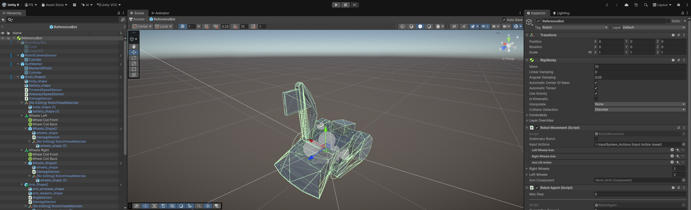
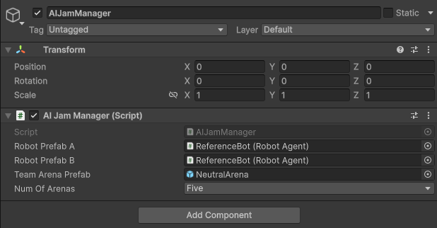
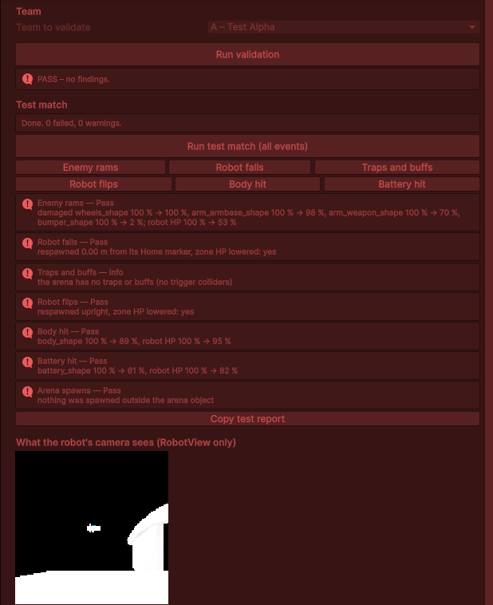
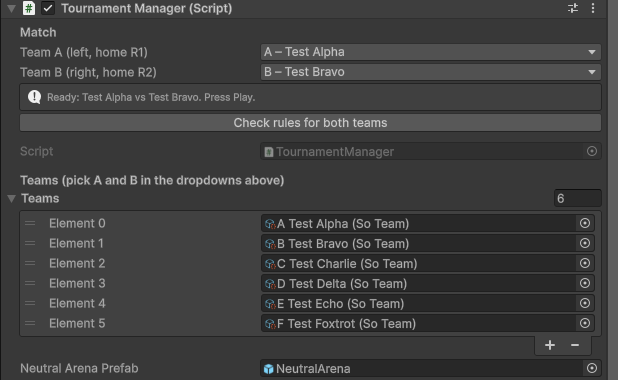
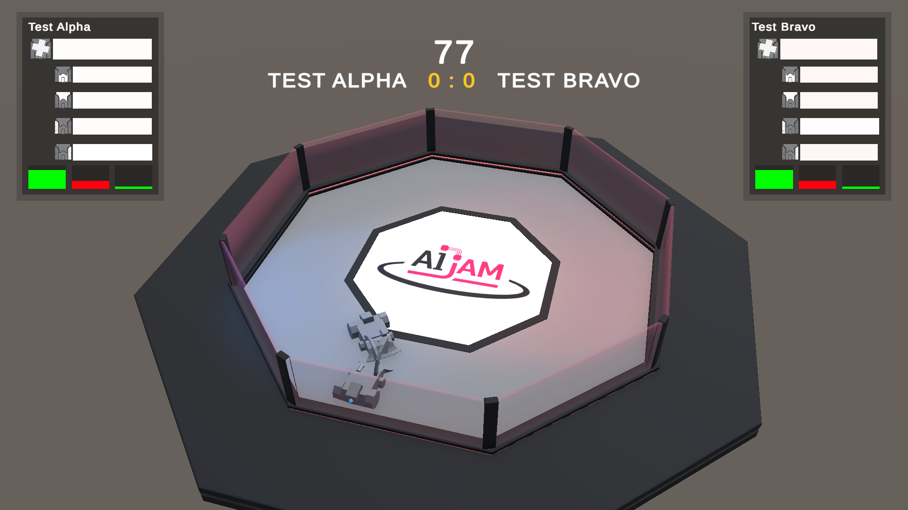

# AI JAM

Turnaj robotov ovládaných umelou inteligenciou, postavený v Unity s ML-Agents.
1. Váš tím si z pripravených dielov postaví robota a domácu arénu.
2. Robota natrénujete pomocou učenia s posilňovaním (reinforcement learning).
3. V deň turnaja bojuje proti robotom ostatných tímov.

Priebeh podujatia:
- **Hackathon:** tímy stavajú a trénujú robota a arénu. Farby, ktoré vidí kamera robota, sa oznámia na začiatku.
- **Prezentácie a finálna validácia:** po prezentáciách organizátori skontrolujú každý tím.
- **Turnaj:** zápasy tímov.

## Obsah

| Kapitola | Čo v nej nájdete |
|---|---|
| [1. Inštalácia](#1-inštalácia) | Nástroje, kontrola inštalácie, otvorenie projektu |
| [2. Stavba](#2-stavba) | Robot, domáca aréna, tímový asset, prehľad dielov |
| [3. Tréning](#3-tréning) | Trénovacia scéna, spustenie trénera, použitie modelu, imitačné učenie |
| [4. Validácia](#4-validácia) | Kontrola pravidiel a testovací zápas |
| [5. Turnaj](#5-turnaj) | Turnajová scéna a ovládanie |
| [6. Pravidlá](#6-pravidlá) | Pravidlá tímu, robota, arény a zápasu, poškodenie a HP |
| [7. Pre organizátorov](#7-pre-organizátorov) | Nastavenie pravidiel, finálna validácia, réžia a rozhodca |
| [8. Riešenie problémov](#8-riešenie-problémov) | Časté chyby a ich oprava |

---

## 1. Inštalácia

Používajte presne tieto verzie. Projekt aj natrénované modely od nich závisia, preto nič neaktualizujte.

| Komponent | Verzia |
|---|---|
| Unity Editor | **6000.6.6f1** |
| Balík ML-Agents pre Unity (`com.unity.ml-agents`) | 4.1.0 (nainštaluje sa automaticky s projektom) |
| Python | **3.10.12** (`mlagents` vyžaduje 3.10.1–3.10.12) |
| Pythonový balík ML-Agents (`mlagents`) | **1.1.0** |
| PyTorch | **2.2.2** (verzia pre CUDA 12.1 na grafiky NVIDIA) |

### 1.1 Git
Nainštalujte [Git for Windows](https://git-scm.com/download/win).

### 1.2 Unity
1. Nainštalujte [Unity Hub](https://unity.com/download).
2. V Unity Hub otvorte **Installs → Install Editor → Archive** a nainštalujte **6000.6.6f1**. Ďalšie moduly pre platformy nepotrebujete.

### 1.3 Pythonové prostredie (Miniconda)
1. Nainštalujte [Minicondu](https://docs.conda.io/en/latest/miniconda.html).
2. Otvorte **Anaconda Prompt** a vytvorte prostredie `mlagents`:

```
conda create -n mlagents python=3.10.12 -y
conda activate mlagents
```

3. Nainštalujte PyTorch. S grafikou NVIDIA použite verziu pre CUDA 12.1:

```
pip install torch==2.2.2 --index-url https://download.pytorch.org/whl/cu121
```

   Bez grafiky NVIDIA nainštalujte verziu pre procesor. Tréning je pomalší, ale funguje:

```
pip install torch==2.2.2
```

4. Nainštalujte ML-Agents a nechajte `setuptools` pod verziou 81. `mlagents` 1.1.0 ešte potrebuje `pkg_resources`, ktoré setuptools 81 odstránil.

```
pip install mlagents==1.1.0 "setuptools<81"
```

> **Chyby SSL?** Niektoré antivírusy (Norton, Avast…) a firemné siete kontrolujú HTTPS, takže `pip`, `conda` alebo `git` zlyhajú s chybou *certificate verify failed*. Riešenie:
> - **pip a conda:** exportujte balík certifikátov (CA bundle), ktorý obsahuje koreňový certifikát antivírusu, a nastavte ho cez `set PIP_CERT=<cesta-k-bundle.pem>` (pip) alebo `set CONDA_SSL_VERIFY=<cesta-k-bundle.pem>` (conda).
> - **git:** použite `git -c http.sslBackend=schannel clone ...`.

### 1.4 Kontrola inštalácie
V Anaconda Prompte s aktívnym prostredím `mlagents`:

```
python --version
python -c "import torch; print(torch.__version__, torch.cuda.is_available())"
mlagents-learn --help
```

Mali by ste vidieť:
- `Python 3.10.12`;
- `2.2.2+cu121 True` (alebo `2.2.2 False` pri verzii pre procesor);
- nápovedu `mlagents-learn` bez chýb.

Ak `mlagents-learn` zlyhá s chybou `No module named 'pkg_resources'`, spustite `pip install "setuptools<81"`.

### 1.5 Stiahnutie a otvorenie projektu

1. Naklonujte repozitár:

```
git clone --depth 1 https://github.com/LuLa-90/AI-JAM-2025.git D:\AI-JAM-2026
```

   Prepínač `--depth 1` stiahne iba aktuálny stav projektu (asi 100 MB). Bez neho by sa stiahla celá história repozitára, asi 1,5 GB. Novšie zmeny si neskôr stiahnete bežným `git pull`.

2. V Unity Hub kliknite na **Add → Add project from disk** a vyberte priečinok `D:\AI-JAM-2026`. Otvorte ho vo verzii **6000.6.6f1**. Prvý import trvá niekoľko minút.
3. **Importujte zdroje TextMesh Pro** (raz pre každý klon, priečinok nie je v Gite): **Window → TextMeshPro → Import TMP Essential Resources**. Bez nich skripty HUD hádžu chyby, Play mode sa pozastaví a tréning vyprší.
4. *(Voliteľné)* Načítajte rozloženie okien projektu: **Window → Layouts → Load Layout from File…** a vyberte `aijam_layout.wlt` v priečinku projektu.
5. Skontrolujte balíky: vo **Window → Package Manager** by mal mať *ML Agents* verziu **4.1.0**. V konzole (Console) by nemali byť červené chyby.

### 1.6 Prehľad projektu
| Kde | Na čo slúži |
|---|---|
| `Assets/Scenes/ConstructionScene` | Stavba robota |
| `Assets/Scenes/ArenaScene` | Stavba arény |
| `Assets/Scenes/TrainingScene` | Tréning a testovanie robota |
| `Assets/Validation/Validation.unity` | Kontrola robota a arény podľa pravidiel a testovací zápas |
| `Assets/Turnaj/Turnaj.unity` | Turnajová scéna (jeden zápas na jedno spustenie Play) |
| `Assets/Prefabs/Base Shapes` | Diely na stavbu (telá, ramená, kolesá, nárazníky, senzory) |
| `Assets/Prefabs/Robot Agent Template.prefab` | Robot, z ktorého začínate |
| `Assets/konfig.yaml` | Nastavenia trénera (hyperparametre PPO) |
| `Assets/DatabaseOfRobots` | Roboty tímov z minulého ročníka s ich modelmi: súperi na tréning ([3.4](#34-imitačné-učenie-a-roboty-z-minulého-ročníka-voliteľné)) |
| `Assets/Demonstrations` | Nahraté ukážky jazdy pre imitačné učenie (3.4) |
| `Assets/Training Results` | Modely zo skúšobných tréningov počas vývoja projektu a robot `Firehawk` |
| `Assets/Validation/Robots/ReferenceBot.prefab` | Robot, ktorý spĺňa všetky pravidlá. Použite ho ako vzor. |

---

## 2. Stavba

Táto kapitola ukazuje postup. Presné limity a zákazy sú v kapitole [6. Pravidlá](#6-pravidlá).

### 2.1 Robot

Otvorte **ConstructionScene**. V objekte `Environment` nájdete šablónu `Robot Agent Template` a ako príklady aj šesť robotov z minulého ročníka. Robot má tri podoby, každú vo vlastnej vrstve (layer):

| Podoba | Vrstva | Kto ju vidí | Pravidlá |
|---|---|---|---|
| Collidery + základný vzhľad | ConstructionView | fyzika, vy v editore | **Prísne**: pravidlá robota platia pre túto podobu |
| Efektný model | TournamentView | divák | **Voľné**: ľubovoľné modely, materiály a efekty, ale bez colliderov |
| Pohľad agenta | RobotView | kamera vášho robota | Iba farby z palety, nastavujú sa automaticky |


*Ten istý robot: vľavo collidery a základný vzhľad (ConstructionView), vpravo to, čo vidí kamera robota (RobotView).*

Postup:
1. **Začnite z `Robot Agent Template`** a ponechajte komponenty koreňa ([pravidlo 6.2.1](#621-koreň-robota)).
2. V **BehaviorParameters** nastavte **Behavior Name** na `RobotAgent`. Musí sa zhodovať s `konfig.yaml`.
3. **Pridajte diely** z `Assets/Prefabs/Base Shapes`: jedno telo, jedno rameno, dve sady kolies a najviac tri nárazníky ([pravidlo 6.2.2](#622-diely)). Každý diel má povolenú inú zmenu veľkosti a iný posun; tabuľka je v pravidle 6.2.2, bod 4.
   - Telo dajte priamo pod koreň. Rameno a nárazníky presuňte pod telo. Kontajnery `Wheels Left` a `Wheels Right` môžu zostať pod koreňom ako v šablóne alebo ich môžete presunúť pod telo; kolesá sa musia iba dotýkať tela.
   - Diely umiestnite a natočte podľa seba. Musia sa dotýkať, ale nesmú sa prekrývať.
4. **Pridajte senzory** (`ProximityRays`, `ButtSensorReciever`) podľa svojej stratégie. Kamera vidí steny čierne, takže ak má robot vnímať steny, pridajte `ProximityRays`.
5. **Farby pohľadu agenta** nenastavujte ručne. Robí to komponent `PartVisionColor` na každom diele ([pravidlo 6.2.5](#625-pohľad-agenta)).
6. Voliteľne pridajte efektný model vo vrstve **TournamentView**, bez colliderov.
7. Robota pretiahnite do okna Project a **uložte ho ako prefab** do priečinka svojho tímu.


*Prefab `ReferenceBot` v Prefab Mode. V hierarchii vľavo je telo (`Body_Shape2`) priamo pod koreňom a kolesá aj rameno sú pod telom. V strede sú collidery, vpravo komponenty koreňa.*

### 2.2 Domáca aréna

Otvorte **ArenaScene**. Začnite z kópie `Assets/Turnaj/Prefabs/NeutralArena` (alebo `Assets/Prefabs/Environment (0, 0)`).


*Neutrálna aréna s robotmi na značkách Home a Guest.*

1. Podlahu a stenu (pevné collidery) nechajte bez zmeny.
2. Ponechajte značky `SpawnPoint` **Home** a **Guest** na ich miestach.
3. Pridajte svoje **pasce a bonusy**: vlastné skripty na trigger collideroch. Pre kameru robota ich označte červenou (pasca) alebo zelenou (bonus) vo vrstve RobotView.
4. Pridajte vzhľad, hudbu, zvuky, efekty alebo NPC podľa seba.
5. Voliteľne nastavte `ArenaViewAngle`: uhol kamery, z ktorého sa nápis na podlahe číta správne.
6. Arénu uložte ako **samostatný prefab**, nie vnútri prefabu robota.

Presné pravidlá arény: [6.3 Aréna](#63-aréna).

### 2.3 Tímový asset

V okne Project kliknite pravým tlačidlom → **Create → AI Jam → Turnaj Team**. Vyplňte:
- `TeamName`: názov tímu;
- `RobotPrefab`: váš robot;
- `ArenaPrefab`: vaša aréna.


Príklady sú v `Assets/Turnaj/Teams`.

### 2.4 Prehľad dielov

Čo je v ktorom prefabe. Hodnoty poškodenia a odolnosti zón sú v časti [6.5](#65-poškodenie-a-hp).

**Vrstvy (layers):**

| Vrstva | Názov | Na čo slúži |
|:---:|---|---|
| 0 | Default | kontajnery, senzory |
| 6 | RobotView | pohľad agenta: jednofarebné kópie dielov, ktoré vidí kamera robota |
| 8 | ConstructionView | **collidery** a základný vzhľad dielov |
| 9 | TournamentView | efektné modely, vidia ich iba turnajové kamery |

**Diely** (`Assets/Prefabs/Base Shapes`):

| Prefab | Komponenty koreňa dielu | Collidery (objekt → zóna) | Senzory v dieli |
|---|---|---|---|
| Body_Shape1, 2, 3 | `BodyComponent` | `body_shape` → body, `battery_shape` → battery | `ForwardSpeedSensor`, `SidewaysSpeedSensor`, `DamageSensor` |
| Arm_Shape1, 2 | `ArmComponent`, vlastné `Rigidbody` (hmotnosť 1) a `HingeJoint`, tag `RobotArm` | `arm_armbase_shape` → armbase, `arm_weapon_shape` → weapon | `AngleSensor`, `DamageSensor` |
| Bumper_Shape1, 2 | `BumperComponent` | `bumper_shape` → bumper | `DamageSensor` |
| Wheels_Shape1, 2, 3 | `WheelComponent` | `wheels_shape` → wheels | `DamageSensor` |

- Všetky collidery dielov sú konvexné `MeshCollider` vo vrstve ConstructionView.
- Každý diel má pod objektom `[No Editing] RobotViewMaterials` svoje kópie pre pohľad agenta (vrstva RobotView, bez colliderov) a komponent `PartVisionColor`, ktorý im nastavuje farbu.
- Rameno má vlastné `Rigidbody`. Jeho `HingeJoint` sa pri štarte pripojí k `Rigidbody` koreňa robota.
- Pohonné wheel collidery **nie sú** v prefaboch kolies. Sú v šablóne robota.

**Senzory** (`Assets/Prefabs/Base Shapes`):

| Prefab | Collidery |
|---|---|
| `ProximityRays` | `Sphere`: pevný guľový collider (polomer asi 1,7 cm), zapnutý, bez zóny poškodenia. Nesmie sa meniť. |
| `ButtSensorReciever` | `Sphere` a `Cylinder`: oba vypnuté a také musia zostať |

**Šablóna robota** (`Robot Agent Template`):

| Objekt | Obsah |
|---|---|
| koreň | `Rigidbody` (hmotnosť 10), `RobotMovement`, `RobotAgent`, `BehaviorParameters`, `DecisionRequester`, kamerový senzor, `CollisionForwarder`, tag `Robot` |
| `Wheels Left`, `Wheels Right` | po 2 wheel collidery (`Wheel Coll Front`, `Wheel Coll Back`). Sem patria sady kolies. `Wheels Right` má mierku X = −1 (zrkadlenie). |
| `RobotCameraSensor` | kamera agenta: 32 × 32 pixelov, farebná |
| `ButtMarker` | `MarkerHitPoint` a `Cylinder`: cieľ, ktorý deteguje súperov senzor `ButtSensorReciever`. Súčasť šablóny, nemeňte ho. |
| `Bounding Box` | dve vizuálne kocky bez colliderov. Pôvodný limit veľkosti, dnes sa nepoužíva: nahrádzajú ho limity dielov (6.2.2, bod 4). |

---

## 3. Tréning

### 3.1 Príprava trénovacej scény
1. Otvorte **TrainingScene** a vyberte **AIJamManager**:
   - **Robot Prefab A:** váš robot. Tento sa učí.
   - **Robot Prefab B:** jeho súper. Môže to byť znova váš robot (obe kópie sa učia tú istú politiku), referenčný robot alebo niektorý robot z minulého ročníka z `Assets/DatabaseOfRobots` ([3.4](#34-imitačné-učenie-a-roboty-z-minulého-ročníka-voliteľné)).
   - **Team Arena Prefab** *(voliteľné)*: prefab vašej domácej arény ([2.2](#22-domáca-aréna)). Keď ho priradíte, tréning beží vo vašej aréne s jej pascami a bonusmi; keď pole necháte prázdne, použije sa neutrálna aréna scény. Roboty pri tréningu štartujú na náhodných miestach okolo stredu, značky Home a Guest sa nepoužívajú.
   - **Num Of Arenas:** One, Three alebo Five. Viac arén zbiera skúsenosti rýchlejšie, ale potrebuje výkonnejší počítač.

   

   > **Pevný súper musí mať Inference Only.** Ak trénujete proti hotovému robotovi, otvorte jeho prefab a nastavte **BehaviorParameters → Behavior Type = Inference Only** s priradeným modelom. Inak ho tréner prevezme tiež (má rovnaký Behavior Name) a prestane hrať podľa svojho modelu.

2. **Skontrolujte Behavior Name na dvoch miestach.** Meno musí byť rovnaké v robotovi aj v konfigurácii trénera:
   - **robot:** otvorte prefab svojho robota a na koreni v komponente **Behavior Parameters** nastavte **Behavior Name** na `RobotAgent`;
   - **konfigurácia:** v `Assets/konfig.yaml` musí byť to isté meno hneď pod riadkom `behaviors:`:

     ```
     behaviors:
       RobotAgent:
         trainer_type: ppo
     ```

   Meno `RobotAgent` nemeňte, vyžaduje ho validácia ([pravidlo 6.2.1](#621-koreň-robota)). Ak sa mená líšia, tréner sa po stlačení Play zastaví s chybou „The behavior name … has not been specified in the trainer configuration“. To isté platí pre konfigurácie imitačného učenia (3.4).
3. Vyberte **Reward Editor** a nastavte posuvníky (0–1). Sú jediný spôsob, ako tréning usmerniť, a určujú štýl robota.
   - **Reward Factors**: malé odmeny v každom kroku za to, ako sa robot pohybuje a kde stojí. Pohyb (Movement), natočenie k súperovi (Facing), uhol ramena (Arm Angle), vzdialenosť od súpera (Enemy Distance), pozícia v aréne (Arena Position) a kombinácia zrážok (Collision Combination).
   - **Fight Factors**: odmeny za samotný súboj. **Hit RF** platí za poškodenie spôsobené súperovi, **Damage Taken RF** trestá za utrpené poškodenie a **Timeout RF** určuje, koľko je hodná výhra na čas oproti vyradeniu.

   
4. *(Voliteľné)* Upravte nastavenia PPO v `Assets/konfig.yaml`.

**Ako sa robot odmeňuje.** Najviac sa oplatí vyhrať vyradením. Posuvníky rozhodujú o tom, akou cestou sa k výhre robot dostane; žiadne nastavenie nespôsobí, že sa oplatí prehrať.

| Odmena | Posuvník | Hodnota |
|---|---|---|
| Výhra (vyradenie súpera) / prehra | – | +1 / −1 |
| Koniec času: robot s vyšším HP / s nižším HP | Timeout RF | 0 až +1 / −1, predvolene +0,5 / −0,5 (pri rovnakom HP 0) |
| Zásah súpera | Hit RF | 0 až 0,2 za jednotku spôsobeného poškodenia, predvolene 0,1 (dlhý súboj má 2 až 4 jednotky) |
| Utrpené poškodenie | Damage Taken RF | 0 až −0,2 za jednotku poškodenia od súpera, predvolene 0 |
| Pohyb, natočenie, vzdialenosť, pozícia | Reward Factors | spolu najviac asi 0,8 bodu za 90 s epizódu, ak sú všetky na maxime |

**Posuvníky naozaj menia správanie.** Dva tréningy referenčného robota proti vlastnej kópii, každý 250 000 krokov, s opačným nastavením:

| Nastavenie | Poškodenie za súboj | Súboje ukončené vyradením | HP na konci |
|---|---|---|---|
| Útočník: Hit 1, Damage Taken 0, Timeout 0, Facing 1, Enemy Distance 1 | 3,2 | 68 % | 35 % |
| Obranca: Hit 0, Damage Taken 1, Timeout 1, Enemy Distance 0, Arena Position 1 | 0,6 | 0 % | 85 % |

Čísla sú z posledných 50 000 krokov a z jedného tréningu na každé nastavenie; berte ich ako smer, nie ako presnú hodnotu.

- **Epizóda pri tréningu trvá najviac 90 s** (pole `Max Episode Seconds` na komponente `RobotAgent`, 0 = bez limitu). Skončí sa aj vyradením. Limit platí iba vtedy, keď je pripojený tréner; turnaj a validácia majú vlastný čas.
- Náraz do steny ani do iného predmetu odmenu nedáva a netrestá sa.
- Pri **Damage Taken RF** nad 0 býva priemerná odmena záporná, lebo trest dostávajú obaja roboti. Nie je to chyba tréningu.
- Ak trénujete robota proti jeho vlastnej kópii, priemerná odmena (Mean Reward) hovorí málo: výhra jedného a prehra druhého sa vyrušia a zostane najmä odmena za zásahy a z posuvníkov. Pokrok vtedy sledujte v TensorBoarde v skupine **Fight** (pozri 3.2) a podľa správania robotov v scéne.

### 3.2 Spustenie trénera
V Anaconda Prompte:

```
conda activate mlagents
cd /d D:\AI-JAM-2026
mlagents-learn Assets/konfig.yaml --run-id=moj_prvy_beh --timeout-wait 300
```

Keď vypíše **„Listening on port 5004"**, stlačte v Unity **Play**. Roboty sa rozbehnú a tréner každých 5000 krokov vypíše štatistiky.

- **Zastavenie:** stlačte **Ctrl+C v prompte**. Tréner vtedy uloží model (`.onnx`). Ak iba ukončíte Play mode v Unity, tréner model neuloží a čaká na ďalšie spustenie Play.
- **Priebežné modely:** tréner sám ukladá model každých 500 000 krokov do `results/<run-id>/RobotAgent/` (nastavenie `checkpoint_interval` v `konfig.yaml`).
- **Pokračovanie behu:** `mlagents-learn Assets/konfig.yaml --run-id=moj_prvy_beh --resume`
- **Beh odznova:** namiesto `--resume` pridajte `--force`.
- **Sledovanie priebehu:** v druhom prompte spustite `tensorboard --logdir results` a otvorte http://localhost:6006.

**Ako spoznať, že sa robot učí.** Okrem odmeny zapisuje projekt do TensorBoardu skupinu **Fight** s priemermi za epizódu:

| Graf | Čo ukazuje | Čo chcete vidieť |
|---|---|---|
| `Fight/Damage Dealt` | poškodenie spôsobené súperovi | rastie |
| `Fight/Damage Taken` | poškodenie od súpera | proti slabšiemu súperovi klesá |
| `Fight/Falls and Flips` | pády z arény a prevrátenia | klesá |
| `Fight/Ended By Knockout` | podiel epizód ukončených vyradením | najprv rastie; neskôr môže klesnúť, keď sa roboty naučia aj brániť |
| `Fight/End HP` | HP robota na konci epizódy | podľa stratégie |

**Koľko to trvá.** Na bežnom počítači s 5 arénami robí tréning v editore 5 000 až 8 000 krokov za minútu. Prvé zlepšenie (viac zásahov, viac vyradení) vidno po 100 000 až 300 000 krokoch, teda asi po hodine. Na dobrého bojovníka počítajte s niekoľkými hodinami.

Príklad zo skúšobného tréningu referenčného robota (1 500 000 krokov, 3 hodiny 20 minút, Fight Factors na predvolených hodnotách, ešte so slabšími Reward Factors): taranovať sa roboty naučili počas prvých 300 000 krokov, keď sa vyradením končili asi tri štvrtiny epizód. Potom sa naučili aj uhýbať a podiel vyradení klesol asi na 15 %. Robot sa pritom ďalej zlepšoval: model z konca tréningu vyhral nad modelom z 500 000 krokov 48 zo 67 súbojov. Pokles vyradení teda sám osebe neznamená, že sa tréning pokazil.

> Editor sa veľmi spomalí, keď nie je aktívnym oknom. Počas tréningu ho majte vpredu.

### 3.3 Použitie natrénovaného modelu
1. Tréner uloží model do `results/<run-id>/RobotAgent.onnx` v priečinku projektu.
2. Skopírujte ho do `Assets/`, napríklad vedľa prefabu robota.
3. Otvorte prefab robota a pretiahnite `.onnx` do **BehaviorParameters → Model**.

   

   *Behavior Name musí byť `RobotAgent`, Model je váš `.onnx` a Behavior Type je Default pri tréningu alebo Inference Only pri teste.*
4. Otestujte ho: v TrainingScene nastavte robotovi **Behavior Type** na **Inference Only** a stlačte Play *bez* spusteného trénera. Ak chcete trénovať ďalej, vráťte ho na **Default**.

### 3.4 Imitačné učenie a roboty z minulého ročníka (voliteľné)
Pri imitačnom učení robot najprv napodobňuje nahraté ručné riadenie a až potom sa zlepšuje podľa odmien. Pomáha to na začiatku tréningu, keď sa robot ešte nevie ani priblížiť k súperovi.

**Hotové ukážky** sú v `Assets/Demonstrations`:

| Súbor | Obsah | Pre robota |
|---|---|---|
| `RamEnemy/` (5 súborov, spolu asi 5 600 krokov) | celý súboj: otočenie k súperovi, náraz, cúvnutie a nový náraz, zdvihnutie ramena pri súperovi | kamera 32 × 32, **Space Size 10** (tohtoročný štandard) |
| `RobotApproachFin.demo`, `RobotApproach.demo`, `RobotApproach_0.demo` | priblíženie k súperovi | Space Size 7 (minulý ročník) |
| `TrainingMoves/` (6 súborov) | otočenie k súperovi z rôznych strán | Space Size 7 (minulý ročník) |

Ukážky `RamEnemy` nenahral človek, ale skriptový vodič `DemoDriver` na referenčnom robote proti jeho modelu. Jazdí ako človek na klávesnici, teda vždy plným príkazom dopredu, dozadu alebo do otáčky.

> **Ukážka sedí iba na robota s rovnakými pozorovaniami.** Tohtoročné roboty majú **Vector Observation → Space Size = 10** ([pravidlo 6.2.6](#626-senzory)) a kameru 32 × 32, preto na ne sedí `RamEnemy`. Ukážky z minulého ročníka majú Space Size 7 a tréner s nimi skončí chybou „shape … do not match“; nechávame ich iba ako príklad.

**Tréning s ukážkou.** Postup je rovnaký ako v [3.2](#32-spustenie-trénera), iba použijete inú konfiguráciu:

```
mlagents-learn Assets/demokonfig_ramenemy.yaml --run-id=<run_id>
```

| Konfigurácia | Čo robí |
|---|---|
| `Assets/demokonfig_ramenemy.yaml` | **pre tohtoročné roboty:** rovnaké nastavenie ako `konfig.yaml` a navyše ukážky `RamEnemy`; napodobňovanie pôsobí prvých 100 000 krokov a postupne slabne |
| `Assets/demokonfig.yaml` | PPO s ukážkou `RobotApproachFin.demo` (Space Size 7); napodobňovanie pôsobí prvých 50 000 krokov |
| `Assets/demokonfig_trainingmoves.yaml` | to isté s ukážkami z `TrainingMoves`, krátky tréning (asi 53 000 krokov) |
| `Assets/demokonfig_nodemo.yaml` | rovnako krátky tréning bez ukážky, na porovnanie |
| `Assets/robot_bc.yaml`, `Assets/robot_bc_only.yaml` | staršie varianty s väčšou dávkou; `robot_bc_only.yaml` nemá odmeny, iba napodobňuje |

Ukážku určuje riadok `demo_path` v časti `behavioral_cloning`. Môže to byť jeden súbor `.demo` alebo priečinok s viacerými.

**Nahratie vlastnej ukážky**
1. Otvorte prefab svojho robota a pridajte komponent **Demonstration Recorder**. Zapnite **Record**, vyplňte **Demonstration Name** a do **Demonstration Directory** napíšte `Assets/Demonstrations`.
2. V **BehaviorParameters** nastavte **Behavior Type** na **Heuristic Only**, aby ste robota riadili vy.
3. V TrainingScene nastavte na **AIJamManager** **Num Of Arenas** na **One**. Inak sa nahrá jeden súbor za každú arénu (`Meno.demo`, `Meno_0.demo`, …) a všetky roboty riadite naraz tými istými klávesmi.
4. Stlačte Play bez spusteného trénera a jazdite:

   | Ovládanie | Klávesnica | Gamepad |
   |---|---|---|
   | Ľavý pás dopredu / dozadu | Q / A | ľavá páčka |
   | Pravý pás dopredu / dozadu | P / L | pravá páčka |
   | Rameno | medzerník | horné tlačidlá (LB, RB) |
5. Zastavte Play. Súbor `.demo` sa uloží do zvoleného priečinka. Ak editor počas nahrávania zastaví Play s chybou „infinite import loop“, nahrávajte do priečinka mimo `Assets` (napríklad `DemoOut`) a súbory potom presuňte do `Assets/Demonstrations`. Nahrávajte iba jazdu, ktorú má robot napodobniť; chyby sa naučí tiež.
6. Pred tréningom vypnite **Record**, vráťte **Behavior Type** na **Default** a **Num Of Arenas** na pôvodnú hodnotu.

**Nahratie bez klávesnice (DemoDriver).** Ak k Demonstration Recorderu pridáte na robota aj komponent **Demo Driver**, robot v režime Heuristic Only jazdí sám: otočí sa k súperovi, narazí, cúvne a narazí znova. Takto vznikli ukážky `RamEnemy`. Hodí sa to, keď chcete ukážky presne pre svoje senzory a nechcete jazdiť ručne. Pri piatich arénach získate za dve minúty asi 5 600 krokov. Pred odovzdaním robota oba komponenty odstráňte; validácia na `DemoDriver` upozorní ako na vlastný skript.

**Pokračovanie z hotového modelu (učiteľ a žiak).** Nový robot môže začať s váhami hotového modelu namiesto náhodných. Skript `Assets/train_student.ps1` skopíruje váhy modelu Santabumpers (`Assets/DatabaseOfRobots/DJeMenTi`) do súboru `Student_Initialized.pt` a spustí tréning s konfiguráciou `Assets/robot_teacher_student.yaml`. Spustite ho v prostredí `mlagents` z priečinka projektu:

```
powershell -ExecutionPolicy Bypass -File Assets\train_student.ps1
```

Funguje to iba vtedy, keď má žiak rovnaké pozorovania a akcie ako učiteľ a Behavior Name `RobotAgent`. Santabumpers má Space Size 7, takže tohtoročnému robotovi (Space Size 10) učiteľom byť nemôže. Ako učiteľa použite model natrénovaný tento rok: zmeňte cestu `teacher_path` v `initialize_student.py`. Prenáša sa iba rozhodovacia sieť; varovania trénera „Failed to load for module Optimizer“ sú preto v poriadku.

**Roboty z minulého ročníka** sú v `Assets/DatabaseOfRobots`, každý tím vo vlastnom priečinku s prefabom robota a jeho modelom `.onnx`. Môžete ich použiť ako súperov pri tréningu: priraďte prefab do **Robot Prefab B** a nastavte mu **Inference Only** (pozri poznámku v [3.1](#31-príprava-trénovacej-scény)). Ich modely vznikli pred úpravou poškodenia, preto nemusia bojovať tak dobre ako vlani. Prefaby v koreni priečinkov tímov (GREGORI, Santabumpers, Rumba2, Job_B 1, Kodzilla pokus, Panzeres) sa v TrainingScene načítajú a bojujú bez chýb. Majú Space Size 7, takže validáciou neprejdú; ako súperom pri tréningu to nevadí.

---

## 4. Validácia

Validačná scéna kontroluje robota a arénu podľa [pravidiel](#6-pravidlá). Používajte ju priebežne už počas stavby, nie až na konci.

### 4.1 Kontrola pravidiel (Run validation)

1. Otvorte `Assets/Validation/Validation.unity`.
2. Vyberte objekt **Validation** a pridajte svoj tímový asset do zoznamu **Teams**.
3. V rozbaľovacom zozname vyberte svoj tím a stlačte **Play**.
4. Kliknite na **Run validation**. Dostanete zoznam chýb a varovaní; kliknutím na položku sa označí príslušný objekt.
   - **Chyby** musíte opraviť.
   - **Varovania** (napríklad vlastné skripty) posúdi človek.

**Iba robot alebo iba aréna.** Ak ešte nemáte tímový asset alebo chcete skontrolovať len jednu vec, použite časť **One robot or one arena** pod tlačidlom Run validation. Play mode na to netreba.
- Do poľa **Robot prefab** pretiahnite prefab robota a kliknite na **Validate robot only**. Skontrolujú sa iba pravidlá robota (6.2); aréna ani tím nie sú potrebné.
- Do poľa **Arena prefab** pretiahnite prefab arény a kliknite na **Validate arena only**. Skontrolujú sa iba pravidlá arény (6.3).
- Keď pole necháte prázdne, tlačidlo skontroluje robota alebo arénu tímu vybraného v zozname.

Pred turnajom aj tak spustite celé **Run validation**: iba ono kontroluje tím ako celok (meno tímu, priradený robot a aréna).

Výsledok bez problémov vyzerá takto:

```
Validation – Test Alpha: PASS (0 errors, 0 warnings)
```

Kontrola modelu zlyhá, kým robota nenatrénujete ([kapitola 3](#3-tréning)). Všetko ostatné môže prejsť už počas stavby.

### 4.2 Testovací zápas (Run test match)

Kliknite na **Run test match**. Váš robot stojí na značke Home vo vašej aréne a na značke Guest stojí skriptovaný súper (`ReferenceBot`). Spustí sa šesť udalostí za sebou; každú môžete spustiť aj samostatne vlastným tlačidlom. Pred každou udalosťou sa obnoví HP aj pozície.

| # | Udalosť | Čo sa stane | Čo sa meria | Kedy je výsledok Pass |
|:---:|---|---|---|---|
| 1 | Enemy rams | súper ide priamo do vášho robota | HP zón a HP robota pred a po | aspoň jedna zóna dostala poškodenie |
| 2 | Robot falls | robot sa zdvihne ponad stenu a pustí von | zmena HP, miesto návratu | robot sa vrátil na svoju značku a HP kleslo o trest za pád |
| 3 | Traps and buffs | robot pomaly prejde stredom každého trigger collidera v aréne | HP, rýchlosť a pozícia počas prechodu | iba meranie (Info), je to návrh tímu |
| 4 | Robot flips | robot sa otočí hore nohami | zmena HP, návrat | robot sa vrátil a HP kleslo o trest za prevrátenie |
| 5 | Body hit | testovacia zbraň narazí do tela | HP zóny tela a HP robota | HP zóny tela kleslo |
| 6 | Battery hit | testovacia zbraň narazí do batérie | HP zóny batérie a HP robota | HP zóny batérie kleslo |

Nakoniec sa skontroluje, že aréna nevytvorila nič mimo objektu arény (riadok **Arena spawns**). Výsledky ukazujú, ako váš robot dostáva poškodenie. Nerozhodujú o tom, či prejdete.

Náhľad kamery ukazuje, čo váš robot vidí.

> **Tip:** Umiestnite kameru robota (`RobotCameraSensor`) tak, aby nevidela vlastného robota. Vlastné biele diely v obraze zakrývajú výhľad a robot si ich môže pomýliť so súperom, ktorého tiež vidí bielou farbou. V náhľade by mal byť iba súper, pasce, bonusy a čierne pozadie.



*Inspector validačnej scény po **Run validation** a **Run test match** (testovací tím, aréna bez pascí). Červený odtieň je farba Unity počas Play mode, nie chyba. Dole je náhľad kamery robota. Tlačidlo **Copy test report** skopíruje výsledky ako text.*

### 4.3 Finálna validácia

Organizátori po prezentáciách spúšťajú rovnaké kontroly pre každý tím. **Robot s chybami nemôže bojovať.** Varovania robota neblokujú, ale posúdi ich človek.

---

## 5. Turnaj

V turnajovej scéne si môžete zápas vyskúšať vopred.

1. Otvorte `Assets/Turnaj/Turnaj.unity` a vyberte objekt **Tournament**.
2. Pridajte svoj tímový asset do **Teams** a v rozbaľovacích zoznamoch vyberte **Team A** a **Team B** (napríklad váš tím proti testovaciemu).

   
3. Stlačte **Play**, kliknite do okna **Game** (klávesy fungujú iba vtedy, keď je aktívne) a stlačte **medzerník** na spustenie odpočítavania.


*Okno Game počas kola: zostávajúci čas, skóre kôl a panely HP oboch tímov.*

| Kláves | Akcia |
|---|---|
| Medzerník | spustenie kola (3-2-1, FIGHT!!) |
| Num 8 / 5 / 2 | kamera zhora / spredu / zblízka |
| Num 1 / 3 | rotujúce kamery |
| Num 4 / 6 | sledovanie tímu A / tímu B |
| W ×2 | rozdeľovač (odtlačí roboty od seba) |
| Q ×2 / E ×2 | knockout tímu A / tímu B |
| R ×2 | opakovanie kola |
| T | pauza / pokračovanie |

Pred Play turnajová scéna skontroluje oba tímy rovnakými pravidlami ako validačná scéna. Výsledok vidíte v Inspectore; tlačidlo **Check rules for both teams** kontrolu zopakuje. Tím s chybami zápas nespustí.

Pravidlá zápasu (kolá, čas, body): [6.4 Zápas](#64-zápas). Podrobnosti pre réžiu a rozhodcu: [7. Pre organizátorov](#7-pre-organizátorov).

---

## 6. Pravidlá

Robot a aréna musia tieto pravidlá splniť, aby tím mohol bojovať v turnaji. Kontroluje ich validačná scéna ([kapitola 4](#4-validácia)). Hodnoty označené *(nie je konečné)* sa oznámia na začiatku hackathonu.

Pravidlá kontrolujú **collidery**, nie vzhľad. Efektný model môže byť ľubovoľný, ale fyzický robot je rovnako veľký a silný ako roboty ostatných.

### 6.1 Tím
1. Tím je jeden asset `soTeam` s poľami `TeamName`, `RobotPrefab` a `ArenaPrefab`.
2. Robot a aréna musia byť **samostatné prefaby**.

### 6.2 Robot

#### 6.2.1 Koreň robota
1. Robot vychádza z prefabu **Robot Agent Template**.
2. Koreň si ponecháva `RobotAgent`, `RobotMovement`, `BehaviorParameters`, `Rigidbody`, `CollisionForwarder` a kamerový senzor. Mierka (scale) koreňa zostáva 1.
3. **Behavior Name** je `RobotAgent`. V `BehaviorParameters` musí byť priradený natrénovaný model (`.onnx`).

#### 6.2.2 Diely
1. Robot sa stavia iba z pripravených prefabov **Base Shapes**. Môžete ich ľubovoľne kombinovať v týchto limitoch:

   | Skupina | Prefaby | Počet |
   |---|---|---|
   | Telo | Body_Shape1, 2, 3 | presne 1 |
   | Rameno (zbraň) | Arm_Shape1, 2 | presne 1 |
   | Sady kolies | Wheels_Shape1, 2, 3 | presne 2: jedna pod `Wheels Left`, jedna pod `Wheels Right`. Rovnaký tvar dvakrát je povolený. |
   | Nárazníky | Bumper_Shape1, 2 | 0–3. Rovnaký tvar viackrát je povolený. |

2. **Štruktúra:**
   - Telo je **priamy potomok koreňa** robota.
   - **Rameno a nárazníky sú pod telom**, v ľubovoľnej hĺbke.
   - **Kolesá pod telom byť nemusia.** Kontajnery `Wheels Left` / `Wheels Right` s wheel collidermi a sadou kolies môžu zostať pod koreňom ako v šablóne alebo byť pod telom. V každom kontajneri je presne jedna sada kolies a tá sa musí dotýkať tela (bod 3).
   - `RobotCameraSensor`, `ButtMarker` a `Bounding Box` môžu zostať pod koreňom.
3. **Diely sa musia dotýkať, ale nesmú sa prekrývať:**
   - kolesá, batéria, nárazníky a rameno sa dotýkajú tela;
   - zbraň sa dotýka ramena;
   - **diely sa nesmú schovávať do seba.** Prefaby dielov sa na svojich pôvodných miestach mierne prekrývajú (napríklad Wheels_Shape1 a Bumper_Shape1 o 4,5 cm) a toto prekrytie je v poriadku. Počíta sa iba to, čo je navyše: koleso smie do tela zasahovať najviac o **2 cm** viac a do nárazníka najviac o **0,5 cm** viac než pri pôvodnom rozložení. Nárazník teda môžete posunúť od kolies, ale nie na ne.
4. **Veľkosť a umiestnenie.** Prefaby dielov sú pripravené tak, že na pozícii (0, 0, 0) pod telom sedia na správnom mieste. Od tohto miesta sa meria posun. Každý diel má vlastné limity:

   | Diel (collider) | Zmena veľkosti | Posun | Otočenie |
   |---|---|---|---|
   | Telo (`body_shape`) | ±25 % | žiadny | žiadne |
   | Batéria (`battery_shape`) | žiadna | ±5 cm v každej osi | žiadne |
   | Kolesá (`wheels_shape`) | ±25 % | žiadny | žiadne |
   | Nárazník (`bumper_shape`) | ±25 % | najviac 25 % vlastnej veľkosti v každej osi | ľubovoľné |
   | Rameno a zbraň (`arm_armbase_shape`, `arm_weapon_shape`) | ±25 % | voľný | voľné |

   - **Nárazník:** posun sa meria pozdĺž jeho vlastných osí, takže limit sa otáča spolu s ním. Bumper_Shape1 má 36 × 12,8 × 23,9 cm (šírka × výška × hĺbka); smie sa teda posunúť najviac o 9 cm do strán, 3,2 cm hore alebo dole a 6 cm dopredu alebo dozadu. Môžete ho otočiť dozadu alebo nabok a posunúť až potom.
   - **Rameno** umiestnite kamkoľvek, musí sa však dotýkať tela (bod 3).
   - **Zrkadlenie** (−1 na osi) je povolené pri všetkých dieloch. Pravá sada kolies je zrkadlená ľavá.
   - Nezáleží na tom, či posuniete celý diel alebo iba collider v ňom: meria sa poloha collidera voči koreňu robota.
5. Objekty so zónami poškodenia sa nesmú premenovať. Ich názvy určujú poškodenie a odolnosť: body, battery, wheels, armbase, weapon, bumper.

#### 6.2.3 Collidery
1. **Každý zapnutý collider na robote musí byť jeden z týchto:**
   - collider pripraveného dielu;
   - collider šablóny (wheel collidery, `ButtMarker`);
   - pevný collider senzora.

   Akýkoľvek iný collider je chyba. Nemôžete pridať štíty, hroty ani skryté bloky.
2. **Tvar:** collider si ponecháva pôvodný mesh. Mesh sa nesmie vymeniť za iný.
3. **Veľkosť:** každá os collidera sa smie líšiť od prefabu dielu najviac o hodnotu z tabuľky v 6.2.2, bod 4 (telo, rameno, zbraň, kolesá a nárazníky ±25 %, batéria 0 %). Každá os sa kontroluje zvlášť.
   - Veľkosť sa meria voči koreňu robota. Počíta sa aj zmena mierky nadradeného objektu.
4. **Pozícia:** podľa tabuľky v 6.2.2, bod 4, a podľa pravidla o dotyku a prekrytí (6.2.2, bod 3). Kópia dielu pre pohľad agenta sa musí hýbať spolu s colliderom. Collidery senzorov a `ButtMarker` sú pevné.
5. Collidery zostávajú zapnuté, pevné (nie triggery) a ponechávajú si fyzikálny materiál.

#### 6.2.4 Uzamknutá fyzika
Tieto nastavenia musia zostať presne ako v šablóne alebo v prefabe dielu:
- hmotnosť, odpor (drag), uhlový odpor a ťažisko Rigidbody (koreň robota a rameno);
- 4 wheel collidery: polomer, odpruženie, trenie a pozícia;
- HingeJoint ramena: pružina, motor a limity.

Nepridávajte ďalšie Rigidbody ani Jointy.

#### 6.2.5 Pohľad agenta
1. Kamera robota vidí **iba vrstvu RobotView** na čiernom pozadí. Turnajová, trénovacia aj validačná scéna toto nastavenie vynútia.
2. Farby *(presné farby sa môžu zmeniť na začiatku hackathonu)*:

   | Farba | Význam |
   |---|---|
   | čierna | pozadie: podlaha, steny a všetko ostatné |
   | biela | časti robota |
   | červená | pasca (vyhni sa jej) |
   | zelená | bonus, buff (choď poň) |
   | modrá | batéria (útoč na ňu) |

3. **Žiadne falošné tvary.** Každý mesh vo vrstve RobotView na robote musí byť vlastná kópia dielu:
   - rovnaký mesh, pozícia, rotácia a veľkosť ako collider toho dielu;
   - kópia batérie je modrá, kópie ostatných dielov sú biele. Farby nastavuje komponent `PartVisionColor` na každom diele podľa `Assets/Validation/VisionPalette.asset`. Komponent aj jeho odkaz na paletu ponechajte;
   - žiadne ďalšie meshe vo vrstve RobotView.
4. To, kam kamera mieri, sa nekontroluje. Čo robot vidí, ukazuje náhľad vo validačnej scéne.

#### 6.2.6 Senzory
1. Senzory (`ProximityRays`, `ButtSensorReciever`) **nie sú obmedzené**. Agent má pevný počet číselných vstupov: **Vector Observation → Space Size = 10** v BehaviorParameters, teda 3 pevné hodnoty o súperovi a 7 miest pre senzory. Senzory navyše preto nedávajú výhodu. Hodnotu nemeňte, validácia ju kontroluje.
2. Collidery senzorov sú pevné:
   - `ProximityRays/Sphere` zostáva presne ako v prefabe;
   - collidery `ButtSensorReciever` zostávajú vypnuté.
3. **Steny:** kamera vidí steny iba ako čierne. Na ich vnímanie slúži senzor `ProximityRays`.

#### 6.2.7 Skripty
Vlastné skripty na robote sú povolené, ale validácia ich vypíše ako varovania a organizátori ich skontrolujú. Skript, ktorý počas zápasu mení fyziku, HP alebo pravidlá, znamená diskvalifikáciu robota.

### 6.3 Aréna
1. **Stred v počiatku.** Koreň prefabu arény je v bode (0, 0, 0), bez rotácie, s mierkou 1. Podlaha je vo výške 0.
2. **Rovnaké pevné collidery ako neutrálna aréna** (`Assets/Turnaj/Prefabs/NeutralArena`). Každý collider, ktorý nie je trigger, musí zodpovedať neutrálnej aréne: rovnaký mesh, pozícia, rotácia a mierka. Podlaha a stena sú teda rovnaké pre všetkých. Nič nesmie chýbať ani pribudnúť.
3. **Žiadne pevné prekážky.** Každý iný collider musí byť **trigger**.
4. **Štartovacie značky.** Aréna má presne jednu značku `SpawnPoint` **Home** a jednu **Guest**. Sú pri podlahe a **súmerné podľa stredu**: pozícia Guest = −pozícia Home (v osiach x a z) a sú otočené o 180° voči sebe.
5. **Pasce a bonusy** sú skripty tímu na trigger collideroch. Validácia nevie posúdiť, čo vlastný kód robí, preto **vypíše každý vlastný skript** v aréne a posúdi ho človek.
6. **Pohľad agenta v aréne:**
   - červená alebo zelená farba smie byť iba na objekte, ktorý má trigger collider alebo je v ňom. Falošné pasce a bonusy sú chyba;
   - biela a modrá sú v aréne zakázané (falošní roboti a batérie);
   - nič iné do vrstvy RobotView nepatrí. Podlaha ani steny tam nemajú kópie; pozadie kamery je čierne.
7. **Povolené voľne:** vlastná hudba, zvuky, vizuálne a časticové efekty a NPC, ktoré nezasahujú do robotov. NPC nemajú pevné collidery (bod 3).
8. **Objekty vytvorené počas behu zostávajú pod arénou.** Všetko, čo aréna vytvorí (NPC, efekty, projektily, zvuky), musí byť **potomkom objektu arény**, aby sa medzi kolami zničilo spolu s ňou. Testovací zápas inak hlási chybu „Arena spawns" a turnajová scéna takéto objekty pri zmene kola zničí.
9. **Voliteľné:** `ArenaViewAngle` nastaví uhol kamery, z ktorého sa nápis na podlahe číta správne.

### 6.4 Zápas
1. **Kolá:** zápas sa hrá na 2 víťazné kolá.
   - 1. kolo je v domácej aréne tímu A.
   - 2. kolo je v domácej aréne tímu B.
   - 3. kolo sa hrá iba pri stave 1:1, v neutrálnej aréne.
2. **Štart:** každé kolo sa začína až na pokyn rozhodcu. Roboty štartujú na značkách Home (domáci tím) a Guest.
3. **Knockout:** kolo vyhráva robot, ktorého súper je vyradený, teda jeho HP klesne na hranicu vyradenia ([6.5](#65-poškodenie-a-hp)).
4. **Pád a prevrátenie:** robot, ktorý vypadne z arény alebo sa prevráti, stratí časť HP na všetkých zónach ([6.5](#65-poškodenie-a-hp)) a vráti sa na svoju značku.
5. **Čas:** kolo trvá 90 s. Po uplynutí času vyhráva robot s vyšším HP.
   - Rovnaké HP v 1. alebo 2. kole: kolo sa opakuje.
   - Rovnaké HP vo finálnom kole: **náhla smrť** (sudden death). Prehráva robot, ktorý ako prvý dostane poškodenie od súpera, vypadne alebo sa prevráti. Dotyk steny alebo podlahy sa nepočíta.
6. **Rozhodca** môže roboty od seba odtlačiť (rozdeľovač), kolo opakovať alebo robota vyradiť.
7. **Ligové body:**

   | Výsledok | Body |
   |---|---|
   | 2:0 | 3 |
   | 2:1 | 2 |
   | 1:2 | 1 |
   | 0:2 | 0 |

### 6.5 Poškodenie a HP
1. Každý diel robota má **zónu poškodenia** s vlastným HP (od 0 do 1). Zóna má dve hodnoty: **poškodenie**, ktoré spôsobuje súperovi, a **odolnosť** voči zásahom.

   | Zóna (názov objektu obsahuje) | Poškodenie | Odolnosť |
   |---|:---:|:---:|
   | `body` (telo) | 1 | 3 |
   | `battery` (batéria) | 1 | 1 |
   | `wheels` (kolesá) | 5 | 4 |
   | `armbase` (základ ramena) | 2 | 3 |
   | `weapon` (zbraň) | 300 | 15 |
   | `bumper` (nárazník) | 1500 | 10 |

2. **Zásah:** keď sa zóny dvoch robotov zrazia, zasiahnutá zóna stráca HP úmerne *sile nárazu* a pomeru *poškodenie súperovej zóny / vlastná odolnosť*. Čím rýchlejší náraz, tým väčšie poškodenie.
   - **Hlavným zdrojom poškodenia je náraz nárazníkom (taranovanie).** Nárazník ubližuje päťkrát viac než úder zbraňou. V skúšobných súbojoch natrénovaných robotov spôsobil asi tri štvrtiny celého poškodenia, zbraň zvyšok.
   - Jeden čelný náraz v plnej rýchlosti uberie robotovi asi 14 % HP. Dobre mierené nárazy vyradia súpera do 90 s; krátko trénované roboty tak končia väčšinu kôl. Dlhšie trénované roboty sa vedia aj brániť a medzi dvoma rovnako dobrými sa väčšina kôl skončí uplynutím času.
   - Batéria je najzraniteľnejšia zóna (odolnosť 1), telo a kolesá sú stredne odolné.
   - Dotyk s arénou bez sily (státie, jazda po podlahe) HP neuberá. Tvrdý náraz do steny áno.
3. **HP robota** je vážený priemer HP jeho zón. Robot je **vyradený**, keď tento priemer klesne na **0,2** alebo nižšie. Ukazovateľ HP v turnaji vtedy ukazuje 0 %.
4. **Pád z arény:** −0,3 HP na každej zóne.
5. **Prevrátenie:** −0,2 HP na každej zóne.
6. Hodnoty zón sa priraďujú podľa **názvu objektu**, preto sa objekty zón nesmú premenovať (6.2.2, bod 5).

---

## 7. Pre organizátorov

Táto kapitola je pre réžiu, rozhodcu a tých, ktorí spravujú validáciu. Tímy ju čítať nemusia.

### 7.1 Nastavenie pravidiel a farieb
- **Limity** sú v `Assets/Validation/ValidationRules.asset`:
  - skupiny dielov a ich počty (minimum, maximum, maximum na jeden prefab);
  - pre každú skupinu `Scale Tolerance Percent` (povolená zmena veľkosti collidera), `Move` (`Free` = voľne, `Fixed` = bez posunu a otočenia, `Percent Of Size` = posun o časť vlastnej veľkosti) a `Move Percent Of Size`;
  - `Battery Move Metres` (5 cm): povolený posun batérie; jej veľkosť a otočenie sú pevné;
  - `Max Wheel Body Penetration` (2 cm) a `Max Wheel Bumper Penetration` (0,5 cm): o koľko smie koleso zasahovať do tela a do nárazníka hlbšie, než sa prefaby prekrývajú na svojich pôvodných miestach;
  - tolerancie pre arénu a štartovacie značky;
  - `Behavior Name`, `Vector Observation Size` (10), šablóna robota, referenčná aréna a paleta.
- **Farby pohľadu agenta** sú v `Assets/Validation/VisionPalette.asset`, jeden materiál na každú úlohu (pozadie, časť robota, pasca, bonus, batéria). Zmena farby v palete prefarbí príslušný materiál vrátane žiary (emission), takže ju prevezmú všetky prefaby. Materiály, ktorých farbu nezmeníte, zostanú nedotknuté, aby roboty z minulého ročníka videli to, na čom boli trénované.
- Validácia rozpoznáva diely podľa **meshu collidera**, nie podľa názvu. Premenovanie objektu kontrolu neobíde.
- **Testy:** po zmene pravidiel alebo kódu spustite **Window → General → Test Runner → EditMode**. Testy validácie sú v `Assets/Validation/Editor/Tests`, testy pravidiel zápasu v `Assets/Turnaj/Scripts/Editor/Tests`.

### 7.2 Finálna validácia tímov
Po prezentáciách skontrolujte tímy po jednom vo validačnej scéne ([kapitola 4](#4-validácia)):
1. Pridajte tímový asset do zoznamu **Teams**, vyberte tím a stlačte Play.
2. **Run validation:** tím s chybami nemôže bojovať. Pri varovaniach si pozrite vypísané vlastné skripty robota a arény a rozhodnite.
3. **Run test match:** sledujte najmä pasce a bonusy (udalosť 3) a riadok **Arena spawns**.
4. Výsledky skopírujte tlačidlom **Copy test report**.

### 7.3 Príprava zápasu
- Turnajová scéna beží **iba v Unity Editore** a jedno spustenie Play je jeden zápas. Rozpis zápasov, výsledky a tabuľka sú mimo Unity (na webe).
- Na objekte **Tournament** sú všetky tímy v zozname **Teams** a neutrálna aréna v poli **Neutral Arena Prefab**.
- **Pred Play** vyberte **Team A** a **Team B**. Inspector ukáže „Ready: A vs B. Press Play." alebo zoznam problémov.
- **Kontrola pravidiel:** chyby zápas zablokujú, varovania nie. Prepínač **Ignore Validation** kontrolu vypne, ak sa v deň turnaja rozhodnete inak. Inspector to potom zreteľne hlási.
- Pri štarte scéna každému robotovi vynúti **Behavior Type = Inference Only** (nič sa nemôže omylom trénovať) a kameru nastaví iba na vrstvu RobotView.
- Nastavenia v časti **Rules**: dĺžka kola (`Round Duration`, 90 s), okno dvojitého stlačenia (0,4 s), sila a prestávka rozdeľovača, vzdialenosť pre návrat robota (0,5 m) a pauza po kole (4 s).

### 7.4 Réžia a rozhodca
| Kto | Čo sleduje | Čo ovláda |
|---|---|---|
| **Réžia** | okno **Game**, maximalizované na vlastnej obrazovke, ktorú sníma OBS | kamery na numerickej klávesnici |
| **Rozhodca** | okno **Scene** na druhej obrazovke | štart kola a zásahy na ľavej strane klávesnice |

- Klávesy sú v tabuľke v [kapitole 5](#5-turnaj). **Fungujú iba vtedy, keď je aktívne okno Game.** Ak nie je, Inspector a okno Scene ukážu červené upozornenie „GAME VIEW NOT FOCUSED". V okne Game sa nikdy nezobrazí.
- **Dvojité stlačenie** (W, Q, E, R): dve stlačenia do 0,4 s. Jedno stlačenie iba ukáže nápovedu v Inspectore a v okne Scene, nie vo vysielaní.
- **F1–F4** sú vyhradené pre OBS (hra / promo / sponzori / web). Unity ich nepoužíva.
- Do okna Game nejdú žiadne informácie pre réžiu. Všetko je v Inspectore a v okne Scene.
- **Kamery 8 / 5 / 2** sa pri každom výbere natočia tak, aby sa nápis na podlahe čítal správne. Uhol určuje `ArenaViewAngle` na koreni arény; predvolená hodnota je 120°.

### 7.5 Priebeh zápasu v scéne
1. **Čakacia obrazovka** (po Play a medzi kolami): „Tím A vs Tím B", názov kola a pomaly krúžiaca kamera. Roboty stoja zmrazené.
2. **Medzerník:** zaznie „Round 1" (alebo „Round 2", „Final round"), beží odpočítavanie 3-2-1, potom „FIGHT!!" a roboty sa uvoľnia.
3. **Počas kola** sú na obrazovke panely HP oboch tímov, skóre kôl a časovač, ktorý pod 10 s sčervenie.
4. **Návrat po páde alebo prevrátení:** robot sa vracia na svoju značku. Ak je súper bližšie než 0,5 m od nej, použije sa bod zrkadlený cez stred arény.
5. **Rozdeľovač (W ×2):** každý robot dostane jednorazový odraz od súpera s miernym nadvihnutím. Sám nespôsobuje poškodenie, ale pád, ktorý vyvolá, sa trestá ako zvyčajne. Má prestávku 1 s a na obrazovke sa krátko ukáže „BREAK!".
6. **Koniec kola:** krátka správa o víťazovi a návrat na čakaciu obrazovku s názvom ďalšieho kola. „Flawless victory" zaznie, keď má víťaz kola na ukazovateli viac než 51 % HP.
7. **Výmena arény:** objekty, ktoré aréna vytvorila mimo seba, scéna pri zmene kola zničí a vypíše varovanie do konzoly.
8. **Koniec zápasu:** obrazovka víťaza so skóre a ligovými bodmi. V Inspectore je rovnaký súhrn a riadok za každé kolo; tlačidlo **Copy result to clipboard** ho skopíruje na zapísanie na web.

### 7.6 Zvuky
Hlasy sú v `Assets/Turnaj/Sounds` a priraďujú sa na objekte **Tournament** v časti **Sounds**: `round-1`, `round-2`, `final-round`, `flawless-victory` a `hahaha` (výhra kola).
- Nahrávky kôl obsahujú aj slovo „Fight". Pole **Fight Cue Seconds** určuje, v ktorej sekunde nahrávky sa „Fight" začína, aby zaznelo až pri nápise „FIGHT!!".
- Polia **Countdown Tick Clip** a **Fight Clip** sú voliteľné a predvolene prázdne.

---

## 8. Riešenie problémov

| Problém | Riešenie |
|---|---|
| `mlagents-learn` vyprší skôr, než stlačíte Play | Pridajte `--timeout-wait 300` alebo stlačte Play skôr po „Listening on port 5004". |
| Play mode sa hneď pozastaví s chybou TMP `NullReferenceException` | Importujte TMP Essential Resources (časť 1.5, krok 3). |
| V TrainingScene sa neobjavia roboty | Nastavte Robot Prefab A a B na **AIJamManager** (časť 3.1). |
| `No module named 'pkg_resources'` | `pip install "setuptools<81"` |
| `torch.cuda.is_available()` vracia `False` s grafikou NVIDIA | Nainštalujte verziu cu121 (časť 1.3) a aktualizujte ovládač grafiky. |
| Súper sa počas tréningu správa čudne | Nastavte mu Behavior Type na **Inference Only** (časť 3.1). |
| Chcete, aby model robota prestal konať | Odstráňte komponent `DecisionRequester`. Vypnutie nestačí: ML-Agents aj tak žiada rozhodnutia. |
| Chyby certifikátov v pip, conda alebo git | Pozrite poznámku o SSL v časti 1.3. |
| Tréner skončí chybou „The behavior name … has not been specified in the trainer configuration“ | Behavior Name robota sa nezhoduje s menom v `konfig.yaml`. Na oboch miestach má byť `RobotAgent` (časť 3.1, krok 2). |
| Tréner skončí chybou „shape … do not match“ | Ukážka alebo model učiteľa má iný počet pozorovaní než váš robot (časť 3.4). |
| Validácia hlási „Vector observation size is …, must be 10“ | V BehaviorParameters nastavte **Vector Observation → Space Size** na 10 ([pravidlo 6.2.6](#626-senzory)) a robota natrénujte znova. |
