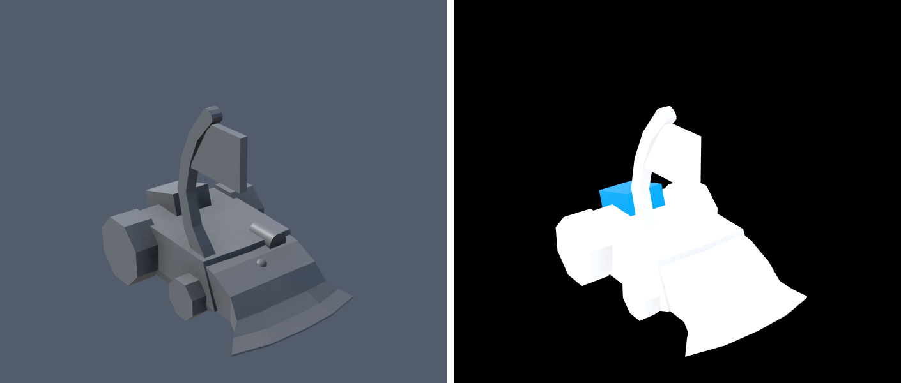
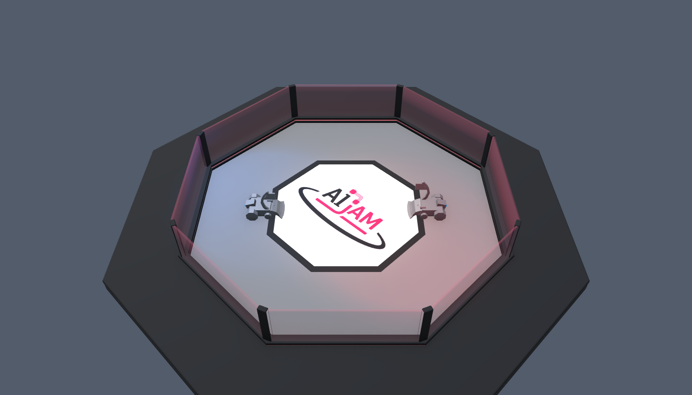
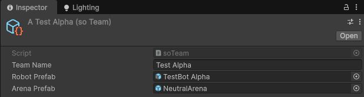
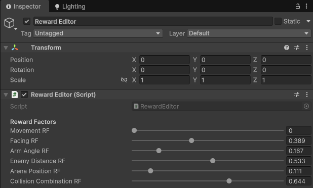
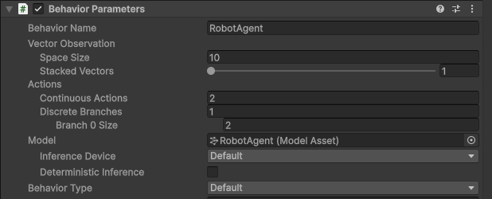

# AI JAM

Turnaj robotov ovládaných umelou inteligenciou, postavený v Unity s ML-Agents.
1. Váš tím si z pripravených dielov postaví robota a domácu arénu.
2. Robota natrénujete pomocou učenia s posilňovaním (reinforcement learning).
3. V deň turnaja bojuje proti robotom ostatných tímov.

Priebeh podujatia:
- **Hackathon:** tímy stavajú a trénujú robota a arénu. Farby, ktoré vidí kamera robota, sa oznámia na začiatku.
- **Prezentácie a finálna validácia:** po prezentáciách organizátori skontrolujú každý tím.
- **Turnaj:** zápasy tímov.

Tento návod vás prevedie všetkými krokmi, od inštalácie až po zápas v turnajovej scéne. Podrobné pravidlá sú v dokumentoch na konci.

---

## 1. Inštalácia nástrojov

Používajte presne tieto verzie. Projekt aj natrénované modely od nich závisia, preto nič neaktualizujte.

| Komponent | Verzia |
|---|---|
| Unity Editor | **6000.6.6f1** |
| Balík ML-Agents pre Unity (`com.unity.ml-agents`) | 4.1.0 (nainštaluje sa automaticky s projektom) |
| Python | **3.10.12** (`mlagents` vyžaduje 3.10.1–3.10.12) |
| Pythonový balík ML-Agents (`mlagents`) | **1.1.0** |
| PyTorch | **2.2.2** (verzia pre CUDA 12.1 na grafiky NVIDIA) |

### 1.1 Git
Nainštalujte [Git for Windows](https://git-scm.com/download/win).

### 1.2 Unity
1. Nainštalujte [Unity Hub](https://unity.com/download).
2. V Unity Hub otvorte **Installs → Install Editor → Archive** a nainštalujte **6000.6.6f1**. Ďalšie moduly pre platformy nepotrebujete.

### 1.3 Pythonové prostredie (Miniconda)
1. Nainštalujte [Minicondu](https://docs.conda.io/en/latest/miniconda.html).
2. Otvorte **Anaconda Prompt** a vytvorte prostredie `aijam`:

```
conda create -n aijam python=3.10.12 -y
conda activate aijam
```

3. Nainštalujte PyTorch. S grafikou NVIDIA použite verziu pre CUDA 12.1:

```
pip install torch==2.2.2 --index-url https://download.pytorch.org/whl/cu121
```

   Bez grafiky NVIDIA nainštalujte verziu pre procesor. Tréning je pomalší, ale funguje:

```
pip install torch==2.2.2
```

4. Nainštalujte ML-Agents a nechajte `setuptools` pod verziou 81. `mlagents` 1.1.0 ešte potrebuje `pkg_resources`, ktoré setuptools 81 odstránil.

```
pip install mlagents==1.1.0 "setuptools<81"
```

> **Chyby SSL?** Niektoré antivírusy (Norton, Avast…) a firemné siete kontrolujú HTTPS, takže `pip`, `conda` alebo `git` zlyhajú s chybou *certificate verify failed*. Riešenie:
> - **pip a conda:** exportujte balík certifikátov (CA bundle), ktorý obsahuje koreňový certifikát antivírusu, a nastavte ho cez `set PIP_CERT=<cesta-k-bundle.pem>` (pip) alebo `set CONDA_SSL_VERIFY=<cesta-k-bundle.pem>` (conda).
> - **git:** použite `git -c http.sslBackend=schannel clone ...`.

### 1.4 Kontrola inštalácie
V Anaconda Prompte s aktívnym prostredím `aijam`:

```
python --version
python -c "import torch; print(torch.__version__, torch.cuda.is_available())"
mlagents-learn --help
```

Mali by ste vidieť:
- `Python 3.10.12`;
- `2.2.2+cu121 True` (alebo `2.2.2 False` pri verzii pre procesor);
- nápovedu `mlagents-learn` bez chýb.

Ak `mlagents-learn` zlyhá s chybou `No module named 'pkg_resources'`, spustite `pip install "setuptools<81"`.

---

## 2. Stiahnutie a otvorenie projektu

1. Naklonujte repozitár:

```
git clone https://github.com/LuLa-90/AI-JAM-2025.git
```

2. V Unity Hub kliknite na **Add → Add project from disk** a vyberte priečinok `AI-JAM-2025`. Otvorte ho vo verzii **6000.6.6f1**. Prvý import trvá niekoľko minút.
3. **Importujte zdroje TextMesh Pro** (raz pre každý klon, priečinok nie je v Gite): **Window → TextMeshPro → Import TMP Essential Resources**. Bez nich skripty HUD hádžu chyby, Play mode sa pozastaví a tréning vyprší.
4. *(Voliteľné)* Načítajte rozloženie okien projektu: **Window → Layouts → Load Layout from File…** a vyberte `aijam_layout.wlt` v priečinku projektu.
5. Skontrolujte balíky: vo **Window → Package Manager** by mal mať *ML Agents* verziu **4.1.0**. V konzole (Console) by nemali byť červené chyby.

### Prehľad projektu
| Kde | Na čo slúži |
|---|---|
| `Assets/Scenes/ConstructionScene` | Stavba robota |
| `Assets/Scenes/ArenaScene` | Stavba arény |
| `Assets/Scenes/TrainingScene` | Tréning a testovanie robota |
| `Assets/Validation/Validation.unity` | Kontrola robota a arény podľa pravidiel a testovací zápas |
| `Assets/Turnaj/Turnaj.unity` | Turnajová scéna (jeden zápas na jedno spustenie Play) |
| `Assets/Prefabs/Base Shapes` | Diely na stavbu (telá, ramená, kolesá, nárazníky, senzory) |
| `Assets/Prefabs/Robot Agent Template.prefab` | Robot, z ktorého začínate |
| `Assets/konfig.yaml` | Nastavenia trénera (hyperparametre PPO) |
| `Assets/Training Results` | Roboty a modely z minulého ročníka (dobrí súperi na tréning) |
| `Assets/Validation/Robots/ReferenceBot.prefab` | Robot, ktorý spĺňa všetky pravidlá. Použite ho ako vzor. |

---

## 3. Stavba robota

Otvorte **ConstructionScene**. Robot má tri podoby, každú vo vlastnej vrstve (layer):

| Podoba | Vrstva | Kto ju vidí | Pravidlá |
|---|---|---|---|
| Collidery + základný vzhľad | ConstructionView | fyzika, vy v editore | **Prísne**: všetko nižšie platí pre túto podobu |
| Efektný model | TournamentView | divák | **Voľné**: ľubovoľné modely, materiály a efekty, ale bez colliderov |
| Pohľad agenta | RobotView | kamera vášho robota | Iba farby z palety, nastavujú sa automaticky |


*Ten istý robot: vľavo collidery a základný vzhľad (ConstructionView), vpravo to, čo vidí kamera robota (RobotView).*

Postup:
1. **Začnite z `Robot Agent Template`.** Ponechajte komponenty koreňa: `RobotAgent`, `RobotMovement`, `BehaviorParameters`, `Rigidbody`, `CollisionForwarder` a kamerový senzor. Mierka (scale) koreňa zostáva 1.
2. V **BehaviorParameters** nastavte **Behavior Name** na `RobotAgent`. Musí sa zhodovať s `konfig.yaml`.
3. **Pridajte diely** z `Assets/Prefabs/Base Shapes`:

   | Skupina | Prefaby | Počet |
   |---|---|---|
   | Telo | Body_Shape1, 2, 3 | presne 1, priamy potomok koreňa |
   | Rameno (zbraň) | Arm_Shape1, 2 | presne 1 |
   | Sady kolies | Wheels_Shape1, 2, 3 | presne 2: jedna pod `Wheels Left`, jedna pod `Wheels Right` |
   | Nárazníky | Bumper_Shape1, 2 | 0–2 |

   - Každý diel okrem tela je **pod telom**, v ľubovoľnej hĺbke. Platí to aj pre kontajnery `Wheels Left/Right`.
   - Diely sa musia **dotýkať, ale nesmú sa prekrývať**. Koleso nemôžete schovať do tela: do tela smie zasahovať najviac 2 cm a do nárazníka najviac 0,5 cm.
   - Diely môžete ľubovoľne umiestniť a natočiť. Každú os collidera môžete zmeniť najviac o **±25 %** *(nie je konečné)*.
   - Nepremenúvajte objekty so zónami poškodenia (body, battery, wheels, armbase, weapon, bumper). Ich názvy určujú poškodenie a odolnosť.
   - Nepridávajte collidery, Rigidbody ani Jointy a nemeňte hmotnosť ani nastavenia kolies a závesu ramena. Fyzika je uzamknutá.
4. **Senzory** (`ProximityRays`, `ButtSensorReciever`) nie sú obmedzené. Kamera vidí steny čierne, takže ak má robot vnímať steny, pridajte `ProximityRays`.
5. **Farby pohľadu agenta** nastavuje komponent `PartVisionColor` na každom diele podľa `Assets/Validation/VisionPalette.asset`. Komponent nechajte na dieli a meshe vo vrstve RobotView nefarbite ručne:

   | Farba | Význam |
   |---|---|
   | čierna | pozadie (podlaha, steny a všetko ostatné) |
   | biela | časti robota |
   | modrá | batéria: útoč na ňu |
   | červená | pasca: vyhni sa jej |
   | zelená | bonus (buff): choď poň |

6. Voliteľne pridajte efektný model vo vrstve **TournamentView**, bez colliderov.
7. Robota pretiahnite do okna Project a **uložte ho ako prefab** do priečinka svojho tímu.


*Prefab `ReferenceBot` v Prefab Mode. V hierarchii vľavo je telo (`Body_Shape2`) priamo pod koreňom a kolesá aj rameno sú pod telom. V strede sú collidery, vpravo komponenty koreňa.*

Všetky pravidlá robota: [`Assets/Validation/ROBOT_RULES.md`](Assets/Validation/ROBOT_RULES.md). Podrobnosti o dieloch a tabuľka poškodení: [`ROBOT_PARTS.md`](Assets/Validation/ROBOT_PARTS.md).

## 4. Stavba domácej arény

Otvorte **ArenaScene**. Začnite z kópie `Assets/Turnaj/Prefabs/NeutralArena` (alebo `Assets/Prefabs/Environment (0, 0)`).


*Neutrálna aréna s robotmi na značkách Home a Guest.*

- Koreň arény zostáva v bode (0, 0, 0) a podlaha je vo výške 0.
- Pevné collidery (podlaha a stena) musia zostať presne ako v neutrálnej aréne. **Všetky ostatné collidery musia byť triggery.**
- Ponechajte presne dva značky `SpawnPoint`, **Home** a **Guest**, umiestnené súmerne podľa stredu a otočené opačným smerom.
- **Pasce a bonusy** sú vaše vlastné skripty na trigger collideroch. Vo vrstve RobotView smú byť červené (pasca) alebo zelené (bonus) a nič iné do RobotView nepatrí.
- Hudba, zvuky, vizuálne efekty a NPC sú povolené. Všetko, čo aréna vytvorí počas behu, musí byť **potomkom objektu arény**.
- Voliteľne: `ArenaViewAngle` nastaví uhol kamery, z ktorého sa nápis na podlahe číta správne.
- Arénu uložte ako **samostatný prefab**, nie vnútri prefabu robota.

Všetky pravidlá arény: [`Assets/Validation/ARENAS.md`](Assets/Validation/ARENAS.md).

## 5. Vytvorenie tímového assetu

V okne Project kliknite pravým tlačidlom → **Create → AI Jam → Turnaj Team**. Vyplňte:
- `TeamName`: názov tímu;
- `RobotPrefab`: váš robot;
- `ArenaPrefab`: vaša aréna.



Príklady sú v `Assets/Turnaj/Teams`.

## 6. Kontrolujte priebežne

1. Otvorte `Assets/Validation/Validation.unity`.
2. Vyberte objekt **Validation** a pridajte svoj tímový asset do zoznamu **Teams**.
3. V rozbaľovacom zozname vyberte svoj tím a stlačte **Play**.
4. Kliknite na **Run validation**. Dostanete zoznam chýb a varovaní; kliknutím na položku sa označí príslušný objekt. Chyby musíte opraviť. Varovania (napríklad vlastné skripty) posúdi človek. Výsledok bez problémov vyzerá takto:

```
Validation – Test Alpha: PASS (0 errors, 0 warnings)
```

Kontrola modelu zlyhá, kým ho nenatrénujete (krok 7). Všetko ostatné môže prejsť už teraz.

## 7. Tréning robota

### 7.1 Príprava trénovacej scény
1. Otvorte **TrainingScene** a vyberte **AIJamManager**:
   - **Robot Prefab A:** váš robot. Tento sa učí.
   - **Robot Prefab B:** jeho súper. Môže to byť znova váš robot (obe kópie sa učia tú istú politiku) alebo niektorý robot z minulého ročníka z `Assets/Training Results`.
   - **Num Of Arenas:** One, Three alebo Five. Viac arén zbiera skúsenosti rýchlejšie, ale potrebuje výkonnejší počítač.

   

   > **Pevný súper musí mať Inference Only.** Ak trénujete proti hotovému robotovi, otvorte jeho prefab a nastavte **BehaviorParameters → Behavior Type = Inference Only** s priradeným modelom. Inak ho tréner prevezme tiež (má rovnaký Behavior Name) a prestane hrať podľa svojho modelu.

2. Vyberte **Reward Editor** a nastavte koeficienty odmien (0–1): pohyb, natočenie k súperovi, uhol ramena, vzdialenosť od súpera, pozícia v aréne a kombinácia zrážok. Určujú, čo sa robot naučí.

   
3. *(Voliteľné)* Upravte nastavenia PPO v `Assets/konfig.yaml`.

### 7.2 Spustenie trénera
V Anaconda Prompte:

```
conda activate aijam
cd <cesta-k>\AI-JAM-2025
mlagents-learn Assets/konfig.yaml --run-id=moj_prvy_beh --timeout-wait 300
```

Keď vypíše **„Listening on port 5004"**, stlačte v Unity **Play**. Roboty sa rozbehnú a tréner každých 5000 krokov vypíše štatistiky.

- **Zastavenie:** Ctrl+C v prompte alebo ukončenie Play mode. Model sa uloží.
- **Pokračovanie behu:** `mlagents-learn Assets/konfig.yaml --run-id=moj_prvy_beh --resume`
- **Beh odznova:** namiesto `--resume` pridajte `--force`.
- **Sledovanie priebehu:** v druhom prompte spustite `tensorboard --logdir results` a otvorte http://localhost:6006. Kumulatívna odmena (cumulative reward) by mala rásť.

> Editor sa veľmi spomalí, keď nie je aktívnym oknom. Počas tréningu ho majte vpredu.

### 7.3 Použitie natrénovaného modelu
1. Tréner uloží model do `results/<run-id>/RobotAgent.onnx` v priečinku projektu.
2. Skopírujte ho do `Assets/`, napríklad vedľa prefabu robota.
3. Otvorte prefab robota a pretiahnite `.onnx` do **BehaviorParameters → Model**.

   

   *Behavior Name musí byť `RobotAgent`, Model je váš `.onnx` a Behavior Type je Default pri tréningu alebo Inference Only pri teste.*
4. Otestujte ho: v TrainingScene nastavte robotovi **Behavior Type** na **Inference Only** a stlačte Play *bez* spusteného trénera. Ak chcete trénovať ďalej, vráťte ho na **Default**.

## 8. Finálna kontrola: validácia a testovací zápas

Vo validačnej scéne s vybraným tímom:
1. **Run validation.** Robot nesmie mať **žiadne chyby**, teraz už vrátane natrénovaného modelu.
2. **Run test match.** Váš robot bojuje proti skriptovanému súperovi vo vašej aréne a meria sa šesť udalostí:
   1. súper do vás narazí;
   2. vypadnete z arény;
   3. prejdete cez svoje pasce a bonusy;
   4. prevrátite sa;
   5. zásah do tela;
   6. zásah do batérie.

   Skontroluje sa aj to, že aréna nevytvára nič mimo objektu arény.

   Náhľad kamery ukazuje, čo váš robot vidí.

   

   *Inspector validačnej scény po **Run validation** a **Run test match** (testovací tím, aréna bez pascí). Červený odtieň je farba Unity počas Play mode, nie chyba. Dole je náhľad kamery robota. Tlačidlo **Copy test report** skopíruje výsledky ako text.*

Organizátori po prezentáciách spúšťajú rovnaké kontroly. **Robot s chybami nemôže bojovať.**

## 9. Vyskúšanie v turnajovej scéne

1. Otvorte `Assets/Turnaj/Turnaj.unity` a vyberte objekt **Tournament**.
2. Pridajte svoj tímový asset do **Teams** a v rozbaľovacích zoznamoch vyberte **Team A** a **Team B** (napríklad váš tím proti testovaciemu).

   
3. Stlačte **Play**, kliknite do okna **Game** (klávesy fungujú iba vtedy, keď je aktívne) a stlačte **medzerník** na spustenie odpočítavania.


*Okno Game počas kola: zostávajúci čas, skóre kôl a panely HP oboch tímov.*

Priebeh zápasu:
- 1. kolo je v aréne tímu A, 2. kolo v aréne tímu B a 3. kolo (iba pri stave 1:1) v neutrálnej aréne.
- Kolo trvá 90 s. Po uplynutí času vyhráva vyššie HP; rovnaké HP vo finálnom kole znamená náhlu smrť (sudden death).
- Ligové body: 2:0 = 3, 2:1 = 2, 1:2 = 1, 0:2 = 0.

| Kláves | Akcia |
|---|---|
| Medzerník | spustenie kola (3-2-1, FIGHT!!) |
| Num 8 / 5 / 2 | kamera zhora / spredu / zblízka |
| Num 1 / 3 | rotujúce kamery |
| Num 4 / 6 | sledovanie tímu A / tímu B |
| W ×2 | rozdeľovač (odtlačí roboty od seba) |
| Q ×2 / E ×2 | knockout tímu A / tímu B |
| R ×2 | opakovanie kola |
| T | pauza / pokračovanie |

Celý návrh turnaja: [`Assets/Turnaj/DESIGN.md`](Assets/Turnaj/DESIGN.md).

---

## Riešenie problémov

| Problém | Riešenie |
|---|---|
| `mlagents-learn` vyprší skôr, než stlačíte Play | Pridajte `--timeout-wait 300` alebo stlačte Play skôr po „Listening on port 5004". |
| Play mode sa hneď pozastaví s chybou TMP `NullReferenceException` | Importujte TMP Essential Resources (krok 2.3). |
| V TrainingScene sa neobjavia roboty | Nastavte Robot Prefab A a B na **AIJamManager**. |
| `No module named 'pkg_resources'` | `pip install "setuptools<81"` |
| `torch.cuda.is_available()` vracia `False` s grafikou NVIDIA | Nainštalujte verziu cu121 (krok 1.3) a aktualizujte ovládač grafiky. |
| Súper sa počas tréningu správa čudne | Nastavte mu Behavior Type na **Inference Only** (krok 7.1). |
| Chcete, aby model robota prestal konať | Odstráňte komponent `DecisionRequester`. Vypnutie nestačí: ML-Agents aj tak žiada rozhodnutia. |
| Chyby certifikátov v pip, conda alebo git | Pozrite poznámku o SSL v kroku 1.3. |

## Dokumenty

Dokumenty v `Assets/` sú v angličtine.

| Dokument | Obsah |
|---|---|
| [`Assets/Validation/ROBOT_RULES.md`](Assets/Validation/ROBOT_RULES.md) | **Pravidlá robota pre tímy** |
| [`Assets/Validation/ARENAS.md`](Assets/Validation/ARENAS.md) | Pravidlá arény, farby pohľadu robota, vrstvy |
| [`Assets/Validation/ROBOT_PARTS.md`](Assets/Validation/ROBOT_PARTS.md) | Všetky diely, ich collidery a tabuľka poškodení |
| [`Assets/Validation/DESIGN.md`](Assets/Validation/DESIGN.md) | Ako funguje validácia a testovací zápas |
| [`Assets/Turnaj/DESIGN.md`](Assets/Turnaj/DESIGN.md) | Ako funguje turnajová scéna |
| [`documentation.md`](documentation.md) | Pôvodná dokumentácia projektu |
| [`Config_README.md`](Config_README.md) | Pôvodné poznámky k tréningu (konfigurácia je teraz `Assets/konfig.yaml`) |
